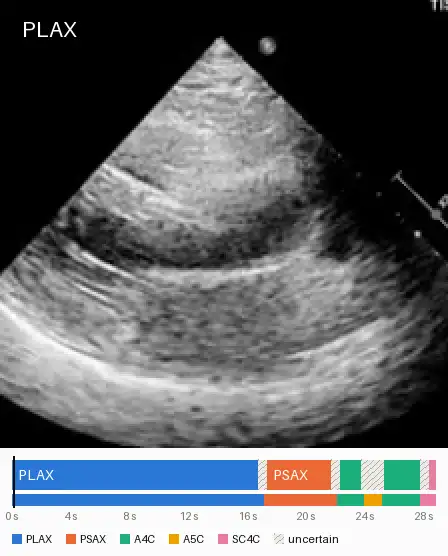
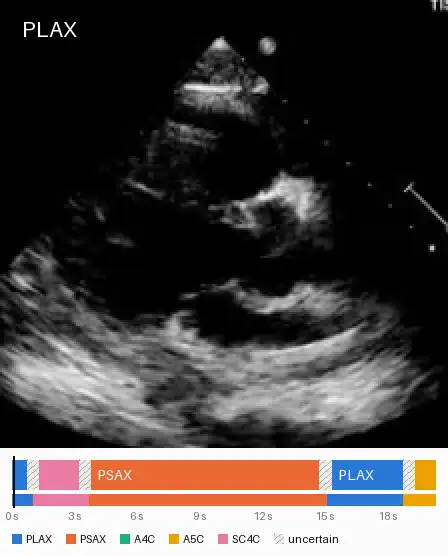

# EchoRouter

[](https://github.com/WilliamQiuzy/echo-view-routing/actions/workflows/ci.yml)
[](https://github.com/WilliamQiuzy/echo-view-routing/releases)
[](LICENSE)
[](https://huggingface.co/WilliamQiu123/echo-view-routing)
[](pyproject.toml)

EchoRouter reads echocardiography video and names the view: **PLAX, PSAX, A4C, A5C or SC4C**. For a longer stream, such as several recordings of one examination joined together, it also says where one view ends and the next begins. Where its evidence is weak, most often right at a change of view, it can answer **uncertain** instead of naming a view. This repository holds the code to run it, to evaluate it and to train it. The weights are on the [Hugging Face Hub](https://huggingface.co/WilliamQiu123/echo-view-routing).

<p>
  
  
</p>

Two streams of public EV9V recordings, run with `--uncertain`. The left one joins the recordings of one examination in their order (29 s). The right one is built from fragments of several recordings (20 s). The wide lane is EchoRouter's answer for every 0.1 s, hatched where it declines. The narrow lane is the reference.

- **What to look for.** Every named sample of both streams is right. The hatched parts sit at the changes of view, 0.3 s to each side. In the left stream the 1.2 s of A5C between two A4C parts is left unnamed as a whole. The system's own two cuts there are 1.0 s apart, and what their bands leave between them is shorter than the 0.5 s a named part must have.
- **How they were picked.** By hand. Both come from the half of the development benchmark that the rule was not chosen on. Of its 156 multi and examination-order streams, 118 have no wrong named sample, and the two were picked among those.
- **Your own recordings.** `python tools/render_demo.py clip1.mp4 clip2.mp4 --uncertain --out demo.webp` makes such a picture.

```text
recording ──► 10 frames per second, grey, 224 × 224
          ──► window model: one prediction every 0.5 s from 16 frames (three seeds, averaged)
          ──► one view per recording, or a change-point decoder that cuts a stream into views
          ──► on request: the weak parts of a stream are marked uncertain instead of named
```

## How it compares

On the project's frozen EV9V test benchmark we ran four published approaches beside EchoRouter, on the same recordings and the same streams.

| System | Streams: segment F1 at 50% overlap | Single recordings: accuracy | Single recordings: macro-F1 |
|---|---|---|---|
| **EchoRouter** | **0.909** | 98.1% | 0.956 |
| EchoViewCLIP, stage 1, sliding window | 0.867 | **98.9%** | **0.972** |
| STFM | 0.859 | 98.3% | 0.960 |
| ASFormer on frame features | 0.856 | 98.3% | 0.956 |
| EchoPrime's view classifier with our decoder | 0.851 | 97.9% | 0.944 |

- **Where EchoRouter is ahead: cutting a stream into views.** Its segment F1 is 0.04 to 0.06 above the others. A paired bootstrap was made for two single stage-2 models, each of which scores 0.919 on the same streams: both are 0.05 to 0.07 ahead of each of the four, and every interval lies above zero. The ensemble itself was not compared pairwise.
- **Where it is not ahead: naming a single recording.** There the five are close, and EchoViewCLIP is the best of them.
- **How to read the table.** We ran all five. STFM, ASFormer and EchoViewCLIP were trained by us on EV9V's training recordings, and EchoPrime's classifier is the released one with our decoder on its outputs. The benchmark is ours, it is not the task these methods were published for, and it is not an untouched test set. The four other rows date from 2026-10-23, EchoRouter's from 2026-11-13.

## Quick start

```bash
git clone https://github.com/WilliamQiuzy/echo-view-routing
cd echo-view-routing
python -m venv .venv && source .venv/bin/activate
pip install -e .

echoview selfcheck       # downloads the weights and five sample clips, then compares with stored results
```

The self-check takes seconds on a GPU and about three minutes on a laptop CPU. It ends with `SELF-CHECK PASSED`.

`pip install -e .` accepts any recent PyTorch. To get the exact versions the project was checked with (Python 3.12), install the pinned requirements first: `pip install -r requirements.txt && pip install --no-deps -e .`

**With Docker**, nothing is installed on the host:

```bash
docker run --rm -v echoview-cache:/cache ghcr.io/williamqiuzy/echo-view-routing:latest echoview selfcheck
```

Add `--gpus all` on a machine with an NVIDIA GPU. [docs/DOCKER.md](docs/DOCKER.md) shows how to mount recordings and where results go.

```bash
# one view per recording; a folder is searched for DICOM and video files
echoview classify /path/to/recordings --out views.csv

# join recordings in the given order into one stream and cut it into views
echoview segment clip1.dcm clip2.dcm clip3.dcm --out segments.csv --samples samples.csv

# the same, and leave the weak parts unnamed: they come back as pieces called "uncertain"
echoview segment clip1.dcm clip2.dcm clip3.dcm --uncertain --out segments.csv
```

```python
import echoview

system = echoview.load()                             # the three published seeds as one ensemble
recording = echoview.read_recording("clip.mp4")      # DICOM cine, video file or folder of frames
result = system.classify(recording.frames)
print(result.view, result.probability, result.seeds_agree)

for start, end, view, probability in system.segment(recording.frames).segments:
    print(f"{start:6.1f} - {end:6.1f} s  {view}  {probability:.2f}")

declining = system.segment(recording.frames, echoview.uncertain.released())   # with the uncertain output
print(declining.uncertain.mean())                                             # the share of samples left unnamed
```

Options for every command:

- `--weights DIR` uses a local folder instead of a download. The environment variable `ECHOVIEW_WEIGHTS` does the same.
- `--device cpu|cuda|cuda:1|mps`. The default is an NVIDIA GPU if PyTorch sees one, else the CPU.
- `--seeds 0` runs one seed instead of three. It is three times faster and no longer the reference system.
- `--fps` gives the frame rate of inputs that carry none. A folder of frame images always needs it.

## How it works

- **Input.** Each recording is brought to 10 frames per second. Each frame is resized so that its short side is 256 pixels, cropped to the central 224 × 224 and reduced to grey levels.
- **Window model.** One prediction every 0.5 s. Each prediction reads 16 consecutive frames around the requested time. The network is torchvision's MViTv2-S video encoder with a 512-d projection, a second input stem that marks the requested frame, and a linear five-class head.
- **Ensemble.** Three training seeds of the same network. Their probabilities are averaged.
- **Recording view.** The mean of the window probabilities. The largest of the five wins.
- **Stream segmentation.** Every 0.1 s sample takes the probability of the nearest window. A change-point decoder cuts where the probabilities before and after a sample differ and the two sides name different views.
- **Uncertain output, on request.** The decoder runs as above. Then the 0.3 s before and after every cut are marked uncertain, and so is a part whose view hangs on a weak cut or on a narrow margin between two views. Every other sample keeps the view it has without the option.

## Results

All numbers are for the published weights (identifier `C2_ens_v1`).

| Data | What was measured | Result |
|---|---|---|
| EV9V development halves, streams built from labelled recordings | segment F1 at 50% overlap, selection half and calibration half | 0.959 and 0.984 |
| EV9V frozen test benchmark, 120 streams of 4 to 8 fragments | segment F1 at 50% overlap | 0.909 (95% CI 0.883 to 0.934) |
| EV9V frozen test benchmark, 800 single recordings | accuracy and macro-F1 | 98.1% and 0.956 |
| EV9V development, selection half, 577 sequences, with `--uncertain` | samples that keep a view, and wrong samples among them | 92.1%, and 1.0% (0.6 to 1.5) against 3.0% without the option |
| MIMIC-IV-Echo, 9,341 recordings of 1,001 patients (GE machines) | same view as another classifier's table | 95.8% (95.2 to 96.3) |
| MIMIC-IV-Echo, 1,139 streams of 988 of those patients | segment F1 at 50% overlap against that table | 0.882 (0.870 to 0.894) |

The MIMIC rows are agreement between two models, not accuracy: MIMIC-IV-Echo has no reader's view labels. The [model card](MODEL_CARD.md) says how to read each row and what the model cannot do.

## The uncertain output

By default EchoRouter names a view for every 0.1 s of a stream, also where two views meet and where a part looks like two views at once. With `--uncertain` it declines there. The rule was chosen on one half of the EV9V development benchmark and checked on the other half. The numbers below are from the half it was not chosen on.

| 577 sequences, 53,922 samples | Samples that keep a view | Wrong among them |
|---|---|---|
| Every sample named, the default | 100% | 3.0% |
| With `--uncertain` | 92.1% | 1.0% |

- **What becomes uncertain.** 68% of the samples the default output has wrong, and 6% of those it has right. 93% of the true changes of view have an uncertain sample beside them.
- **What it costs.** A part of about a second between two cuts is left unnamed as a whole. A5C loses most: 74% of its samples keep the name A5C, against 89% without the option.
- **What it is not.** Uncertain does not mean "none of the five views". The model cannot tell that. And the study does not show that this rule beats a plain threshold on the model's confidence: a threshold that declines as many samples leaves 1.1% wrong.
- **Where it holds.** On EV9V streams joined from recordings, for the ensemble of three seeds. A continuous examination was not measured. The 577 sequences are built from the same 284 recordings, so the interval in the results table is too narrow as a statement about new recordings.

[docs/UNCERTAIN.md](docs/UNCERTAIN.md) has the plan, which was committed before the results, the choice and the full two-part report.

## Reproduce the evaluation

Both evaluations need the public EV9V dataset (`bgx666/EV9V` on the Hugging Face Hub, CC BY 4.0) and a GPU. Run beside the research code on the same weights, they give its numbers exactly.

```bash
pip install -e ".[evaluation]"
echoview evaluate --images /data/EV9V/Images --out report.json
```

It prints one line per system. The line of the ensemble must read `selection F1@50 0.9594  calibration F1@50 0.9837`.

The frozen test benchmark is run with `echoview evaluate --benchmark test --images /data/EV9V/Images`. Its first line must read `multi streams   segment F1@50 0.9089 (95% interval 0.883 to 0.934)`.

See [docs/EVALUATION.md](docs/EVALUATION.md) for the benchmarks, the metrics, the decoder rule and the study of the uncertain output.

## Train

The model was trained in three stages, each with its recipe in `configs/`. Stage 3 is the stage that produced the published seeds. It continues a stage-2 model for 1,500 updates with input augmentation.

The training code was checked against the research trainer and the published training logs. A full rerun of the three seeds with this package lands within 0.004 of the published seeds on both development halves.

```bash
echoview-cache --images /data/EV9V/Images --out /data/ev9v_cache           # 18 GB, once
echoview-train --config configs/stage3.json --seed 0 --cache /data/ev9v_cache --init stage2 --out runs/C2_s0
```

`--init stage2` downloads the stage-2 model of the seed from the weights repository and checks it.

Stage 3 needs a GPU with 32 GB of memory. On a machine that can be switched off, add `--checkpoint-every 100 --resume`: the run then continues from its last checkpoint. See [docs/TRAINING.md](docs/TRAINING.md) for all three stages and what a rerun can and cannot reproduce.

## Repository layout

| Path | Content |
|---|---|
| `src/echoview/` | the package: model, readers, windows, decoder, ensemble, command line |
| `src/echoview/evaluation/` | the EV9V development and test benchmarks, the metrics, the intervals and the decoder rule |
| `src/echoview/training/` | frame cache, sampling plans, augmentation and the training loop |
| `src/echoview/data/` | the benchmark definitions, the list of recordings and the sampling plans |
| `configs/` | training recipes |
| `docs/` | data, evaluation and training in detail |
| `tests/` | unit tests and parity tests against the research code |
| `tools/` | `render_demo.py` for the animations above, and maintainers' scripts: building the Hub folder, exporting definitions from the research code |
| `requirements.txt`, `requirements-dev.txt` | the pinned versions the project was checked with |
| `Dockerfile` | the image: the package on top of the pinned requirements |

## Data

- **EV9V** is public. The package ships no EV9V file. Its definition files name a recording by a hash of its folder name, so they work with your own copy of the dataset. See [docs/DATA.md](docs/DATA.md).
- **MIMIC-IV-Echo** is restricted-access data. Nothing derived from single MIMIC recordings is in this repository. `echoview mimic-table` runs the model on your own credentialed copy.
- **Sample clips.** The five clips of the self-check are EV9V recordings. They are published with the weights.

## Limits

- **Five views only.** The model has no "other" class. A recording of any other view still gets one of the five names, often with a high probability. The uncertain output does not change this: it marks weak evidence between the five views.
- **A4C against A5C is its weakest distinction.**
- **One training site and vendor.** Robustness to another vendor's recordings comes from input augmentation and was measured as agreement with another classifier.
- **Research use only.** This is not a medical device and it is not validated for clinical use.

## Licence and acknowledgements

- **Code.** MIT, see [LICENSE](LICENSE).
- **Weights.** Not MIT. The encoder was initialised from EchoPrime (Vukadinovic, He, Ouyang and colleagues, Cedars-Sinai Medical Center), which is released under an [Academic Software License](https://github.com/echonet/EchoPrime/blob/main/LICENSE) for academic and nonprofit research. The weights are a derivative of EchoPrime and are offered under the terms of that licence: research use only, no commercial use, and please do not redistribute them. The licence asks publications to include: "The Software used in this research was created by Milos Vukadinovic, Bryan He, and David Ouyang of Cedars-Sinai Medical Center. © 2024 Cedars-Sinai Medical Center."
- **Data.** EV9V is distributed under CC BY 4.0 by its authors.
- **Architecture.** torchvision's `mvit_v2_s` (BSD 3-Clause).

## Citation

A paper is in preparation. Until it is out, please cite this repository. GitHub's "Cite this repository" button reads [CITATION.cff](CITATION.cff).
