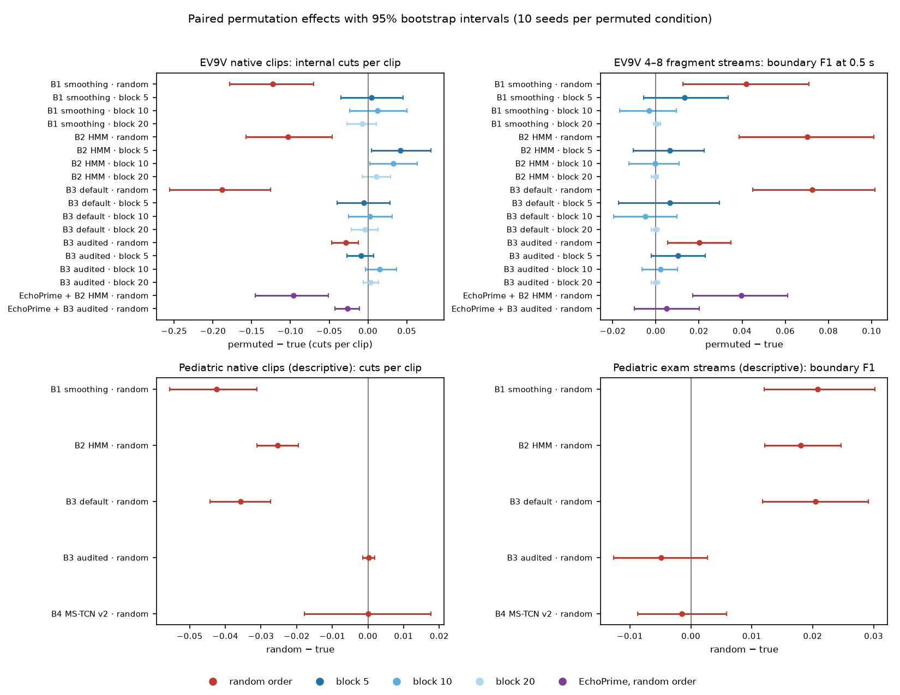

# Independent data check and permutation mechanism (2026-10-01)

This round follows `docs/research_plan.md`, section "下一轮决定（2026-10-01，交给 Claude 执行）". It tests one
candidate explanation. A frame classifier's errors relative to the clip label may come in runs of consecutive
samples. Shuffling the samples inside a clip breaks these runs into isolated flickers, and temporal smoothing removes
isolated flickers easily. Shuffling could therefore make smoothing look better than it would on real video.

**Terms used below.**

- A *native clip* is one whole recorded clip on its own. A *fragment* is a contiguous piece of one clip placed in a
  constructed stream. A *join* is the point where two fragments meet.
- A *deviation* is a sample whose label differs from the clip's label. The reference is the existing clip label, not
  a clinical gold standard.
- An *internal cut* is a label change inside a native clip after decoding. The *same-class cut rate* is the share of
  joins between two fragments of the same class at which the decoder places a change within 0.5 s.
- *Boundary F1* scores predicted changes against joins between different classes, one-to-one, within 0.5 s.
  *Segment F1@50* counts a predicted segment as correct when it has the true class and overlaps a true segment with
  intersection over union of at least 0.5.
- Every time is a position on the 10 Hz sample grid. After a permutation, "seconds" and "per minute" are grid
  equivalents, not physiological time.

## Status

| Item | State |
|---|---|
| Task 0, seed control and isolated naming | Done. The tiny verification passed on CPU. A GPU repeat runs at the start of the queued matrix. |
| Task 1, EV9V permutation mechanism on existing caches | Done. Two identical runs. |
| Task 2, EchoNet-Pediatric inventory, frozen protocol and direct transfer | Done. The fixed pipeline's direct transfer failed and did not reach the frozen external replication standard. Permutation results are descriptive only. |
| Task 3, MS-TCN 3 seeds × 2 training orders | Queued behind the ASFormer retrain (expected start about 15:40 UTC). Not yet executed. |
| Joint true-order comparison with costs | Done, including B5 ASFormer v2 (retrain finished 14:22 UTC, frozen as `asformer_official/v2_frameorder`). |
| Optional Pediatric re-selection of decoding parameters on the calibration folds | Not executed. |

## 1. Executable checklist

### 1.1 Data inventory

- **EV9V, corrected image set.** All frame-derived inputs come from `cache_v2` (frame order `numeric-2026-09-30`)
  and B0 checkpoint `79f4a41af6e3`. The manifest `data/manifests/ev9v_native.csv` lists 5,138 clips (train 3,683,
  validation 567, test 888). The ladder test banks hold 800 native clips in 125 presumed patient groups, 240 pair
  streams and 120 streams of 4–8 fragments built from 405 clips. Patient groups are inferred from the file-name
  prefix and are not verified identities.
- **EchoNet-Pediatric.** The server copy holds 7,810 AVI files (A4C 3,284, PSAX 4,526). All of them open and decode,
  and the decoded frame count equals the container count for every file. Frames are 112 × 112. Frame rates range
  from 21 to 193 frames per second (median 50). Clips are short, with a median of 1.6 s (10th–90th percentile
  0.9–2.8 s).
- **Pediatric splits and groups.** The file lists carry ten official folds (0–9) and no designated test fold. File
  names read `<group>-<exam>-<clip number>`. The 1,939 first-token groups never cross a fold, and age, sex and EF are
  constant within each of the 4,467 exams. 3,133 exams contain both views. The first token is therefore treated as
  the resampling group, but it is not verified as a patient identity.
- **Prior development use of Pediatric.** None was found. No configuration, script or run read the Pediatric files
  before this round. B0 was trained on the EV9V train split only (ImageNet-initialised ResNet-18), and MS-TCN v2 was
  trained on EV9V B0 features. Only the inventory and this round's protocol touched the data.

### 1.2 Frozen protocol and digests

- **Pediatric protocol `pediatric-external-v1`.** It was frozen on the server at 2026-10-01 04:38:11 UTC, before any
  prediction. It sits in `data/manifests/pediatric/pediatric-external-v1/` (read-only files; per-video tables stay on
  the server). `protocol.json` has SHA-256 `54ebcce4da73b7d12937ac285aa1fc96c4a77091e0a0f676a42a2e66388b6f47`, and
  the video table digest is `553e0829cc2255be1a42bb602ff3d3cf3b5cad01e141a8d7e57a73b9e1e55f48`.
- **Pediatric split.** Folds 0–1 form the external calibration part (1,456 videos, 390 groups). Folds 2–9 form the
  test part (6,354 videos, 1,549 groups, 3,623 exams). The main analysis uses the test part only.
- **Pediatric banks.** The `exam` bank joins all clips of one exam in acquisition (clip-number) order. It holds 2,574
  test streams (digest `a92ed2bd…`). The `same` bank pairs same-view clips inside one group. It holds 2,221 test
  pairs (digest `ad396f26…`). Every bank is built inside one group, so no source is shared between groups. Each
  video appears at most once per bank.
- **Acquisition order inside an exam.** All 7,810 clip numbers are six-digit, zero-padded integers, so text order and
  numeric order agree. The code sorts them as integers, and a recomputation after that change reproduced every frozen
  digest.
- **Pediatric preprocessing `ped-ts10hz-letterbox224-v1`.** Samples are the nearest frames to t = k/10 s at each AVI's
  own frame rate. Frames are letterboxed to 224 and normalised exactly as in the EV9V B0 extraction.
- **EV9V recipes.** The ladder configuration `runs/20260928-001145-baselines-1b027c50-s0/config.resolved.yaml`
  (recipe seed 1234) defines every bank. The digest over all banks used here is `f1fb31cd63`. The per-bank SHA-256
  prefixes are listed below. They are computed over the recipe JSON in bank order.

| Bank | Recipes | Digest prefix |
|---|---|---|
| Multi-fragment train bank (MS-TCN training) | 1,500 | `228062c5f9acef9d` |
| Pair streams, validation / test | 240 / 240 | `55eb24725a96e91b` / `e86ba8f0e4b1a099` |
| 4–8 fragment streams, validation / test | 120 / 120 | `17d7cfd690593e1b` / `4fa2ee196e4ba1ce` |
| Native clips, validation / test | 521 / 800 | `477978cf82289659` / `ac6bd193d28e5718` |

### 1.3 Seeds and paths

- `recipe_seed` 1234 is unchanged. Permutation seeds for testing are 100–109. The fixed training permutation seed of
  the matrix is 500. Model seeds are 0, 1 and 2. The three kinds of seed are separate arguments and never derived from
  each other.
- Matrix data live in `data/mstcn_matrix/<data name>`, where the data name is
  `79f4a41af6e3-rf1fb31cd63-tr<true|rand>-ps<na|500>-numeric-2026-09-30`. Models live in
  `third_party/ms-tcn_seeded/models/<data name>-ms<model seed>/split_1/`, each with a `DONE.json` record.
  Predictions go to `cache_v2/mstcn_matrix/<run>/<test condition>/`.
- Pediatric features are in `cache_v2/pediatric/ped-ts10hz-letterbox224-v1/features/79f4a41af6e3/`. Pediatric
  MS-TCN predictions are in `cache_v2/pediatric/ped-ts10hz-letterbox224-v1/b4/79f4a41af6e3/mstcn_v2_frameorder/`.
- None of these paths overlaps the running ASFormer or STFM inputs and outputs.

### 1.4 Queue

1. The ASFormer v2 retrain runs from 03:40 UTC and should end about 15:40 UTC.
2. The job `mstcn_matrix` waits for that process to exit. It then repeats the tiny seed check on the GPU, exports the
   two training conditions, trains seeds 0–2 (the two conditions of one seed side by side), predicts true order and
   the ten test seeds, and evaluates the 2 × 2 table.
3. After ASFormer finishes, B5 joins the corrected model table and the joint comparison.

## 2. Task 0 — seeds and isolation

- The local wrappers `run_mstcn_official.py` and `run_asformer_official.py` pass no seed. The official MS-TCN entry
  hard-codes seed 1538574472, and ASFormer hard-codes 19980125.
- **Correction of the run records.** Every MS-TCN and ASFormer run before this round has a directory name ending in
  `-s0`. That suffix is the wrapper's configuration seed, not the training seed. Each of these runs trained with the
  entry's fixed seed, so a directory name is not evidence of an independent training seed. Any reading of these runs
  as different training seeds, and any seed-variance interpretation built on them, is withdrawn. A search of all
  branches, the result pages and the ledger found no such statement; the ledger already says "official seed". This
  correction covers MS-TCN and ASFormer only. Other models were not checked here.
- A patched copy, `third_party/ms-tcn_seeded`, adds `third_party/patches/ms-tcn-seed.patch` to the pinned clone
  (commit `33ed91c`). The patch takes `--seed` and seeds Python's `random`, NumPy and PyTorch (CPU and CUDA), with
  deterministic cuDNN. Python's `random` sets the official batch order. The entry writes the seed it used and a
  SHA-256 digest of the initial weights. The matrix wrapper adds a `DONE.json` that records the entry, the seed, the
  initial and final weight digests, the data digest and the device.
- The tiny run used 12 training streams, 2 epochs and the CPU. It passed every check below.

| Check | Result |
|---|---|
| Same seed twice gives identical initial weights | yes |
| Same seed twice gives identical final weights | yes |
| A different seed gives different initial weights | yes |
| The true-order and permuted conditions of one seed share initial weights | yes |
| They end with different final weights | yes |
| The seed recorded by the entry equals the requested seed | yes |
| Every run has its own model directory | yes |
| The true-order export equals the export that trained MS-TCN v2 | 12 of 12 streams identical |

## 3. Task 1 — EV9V permutation mechanism (existing caches, no training)

**Setup.** Every test fragment and native clip keeps its frame IDs, B0 probabilities and features from `cache_v2`.
Only the order of samples inside each fragment or clip changes. The conditions are true order, name order (frame IDs
sorted as text, the legacy order), reverse order, full random order (10 seeds), and block orders. A block order cuts
a fragment into blocks of 5, 10 or 20 samples, keeps the order inside each block, and shuffles the blocks with the
same 10 seeds. Validation stays in true order. Decoder settings and routing thresholds therefore come from
true-order validation and are never re-selected per condition. Intervals resample native clips by presumed patient
group, pair streams by stream, and 4–8 fragment streams by clip (these streams reuse clips). Each interval is a 95%
percentile bootstrap over 2,000 draws, and the same draws serve every method, condition and seed.

**Checks.**

- B0's clip macro-F1 (0.944) and frame accuracy (0.950) are identical in all 43 conditions, as they must be.
- Each method selected one identical set of routing thresholds across all conditions.
- A second full run reproduced every metric and every per-clip row exactly.



The figure shows permuted-minus-true effects with 95% intervals. The top row is EV9V (B0 decoders under random and
block orders, and EchoPrime under random order). The bottom row is EchoNet-Pediatric under random order, which is
descriptive only (§4). Full tables are in `effects.md`, and the joint comparison table is in `joint.md`.

### 3.1 Native clips

The table gives the true-order value and the change under each permuted order (permuted minus true, mean over seeds,
95% interval).

| Decoder | Endpoint | True order | Random | Block 5 | Block 10 | Block 20 |
|---|---|---|---|---|---|---|
| B2 HMM | internal cuts per clip | 0.211 | −0.103 [−0.158, −0.046] | +0.042 [+0.005, +0.081] | +0.033 [+0.002, +0.063] | +0.011 [−0.008, +0.029] |
| B2 HMM | deviation rate after decoding | 0.035 | −0.010 [−0.014, −0.006] | −0.003 [−0.005, −0.002] | −0.001 [−0.003, −0.000] | −0.001 [−0.002, −0.000] |
| B3, audited | internal cuts per clip | 0.052 | −0.029 [−0.047, −0.012] | −0.009 [−0.027, +0.008] | +0.015 [−0.003, +0.037] | +0.003 [−0.006, +0.013] |
| B3, audited | deviation rate after decoding | 0.027 | −0.004 [−0.009, −0.001] | −0.003 [−0.007, −0.001] | −0.001 [−0.003, +0.001] | −0.002 [−0.004, +0.000] |
| B1 smoothing | internal cuts per clip | 0.241 | −0.123 [−0.179, −0.070] | +0.004 [−0.035, +0.045] | +0.012 [−0.024, +0.050] | −0.007 [−0.027, +0.011] |
| B3, default | internal cuts per clip | 0.285 | −0.188 [−0.256, −0.125] | −0.005 [−0.040, +0.029] | +0.002 [−0.025, +0.031] | −0.004 [−0.021, +0.013] |

Reverse order leaves the HMM and both B3 settings exactly unchanged on native clips, because these decoders treat
time symmetrically. Name order changes HMM cuts by −0.042 [−0.077, −0.012] per clip. Name order is the partial
shuffle that the legacy loader produced.

### 3.2 Structure of the raw B0 deviations

| Endpoint | True order | Random | Block 5 | Block 10 | Block 20 | Name |
|---|---|---|---|---|---|---|
| Share of deviating samples in runs of ≥ 5 samples | 0.524 | −0.302 | −0.090 | −0.034 | −0.012 | −0.071 |
| Deviation runs per clip | 0.907 | +0.874 | +0.187 | +0.091 | +0.031 | +0.206 |
| Lag-1 autocorrelation of the probabilities | 0.288 | −0.317 | −0.054 | −0.022 | −0.005 | −0.081 |

All differences in this table have 95% intervals that exclude zero except block 20 for the run share
([−0.027, 0.000]). The number of deviating samples is the same in every condition, because only their positions move.
In true order, 18% of deviating samples sit in runs of at least 20 samples. Under random order 13% still do, because
a clip that is mostly wrong stays mostly wrong in any order.

### 3.3 Constructed streams

| Decoder | Bank | Endpoint | True order | Random | Block 5 | Block 10 |
|---|---|---|---|---|---|---|
| B2 HMM | pairs | boundary F1 | 0.930 | +0.036 [+0.008, +0.064] | −0.007 [−0.031, +0.018] | −0.002 [−0.017, +0.015] |
| B2 HMM | 4–8 fragments | boundary F1 | 0.833 | +0.070 [+0.039, +0.101] | +0.006 [−0.010, +0.022] | −0.000 [−0.013, +0.011] |
| B2 HMM | 4–8 fragments | same-class cut rate | 0.149 | −0.023 [−0.052, +0.002] | +0.004 [−0.019, +0.029] | −0.008 [−0.028, +0.011] |
| B3, audited | pairs | boundary F1 | 0.980 | +0.009 [−0.008, +0.032] | +0.002 [−0.014, +0.024] | −0.000 [−0.014, +0.014] |
| B3, audited | 4–8 fragments | boundary F1 | 0.927 | +0.020 [+0.005, +0.035] | +0.010 [−0.002, +0.023] | +0.002 [−0.006, +0.010] |
| B3, audited | 4–8 fragments | same-class cut rate | 0.064 | −0.021 [−0.049, +0.005] | −0.014 [−0.040, +0.008] | −0.012 [−0.033, +0.008] |

**Coverage of the block orders.** A fragment shorter than two blocks cannot be perturbed and is left in true order.
Block 5 perturbs 83% of constructed fragments and 95% of native clips. Block 10 perturbs 34% and 75%. Block 20 perturbs
0.7% and 38%. Block 20 is therefore informative only for native clips.

### 3.4 Second encoder (EchoPrime)

EchoPrime's per-frame probabilities were decoded with their own true-order validation settings. The audited B3
setting for EchoPrime was chosen by the problem A rule (half-window 0.9 s, JS threshold 0.335). The comparison is
true order against the same 10 random seeds.

| Decoder | Endpoint | True order | Random − true |
|---|---|---|---|
| B2 HMM | internal cuts per native clip | 0.134 | −0.096 [−0.145, −0.051] |
| B2 HMM | boundary F1, pairs / 4–8 fragments | 0.949 / 0.872 | +0.042 [+0.017, +0.067] / +0.040 [+0.017, +0.061] |
| B3, audited (EchoPrime setting) | internal cuts per native clip | 0.039 | −0.027 [−0.043, −0.011] |
| B3, audited (EchoPrime setting) | boundary F1, pairs / 4–8 fragments | 0.971 / 0.922 | +0.021 [+0.004, +0.042] / +0.005 [−0.010, +0.020] |

EchoPrime's raw deviations are also clustered. In true order, 54% of its deviating samples are in runs of at least 5
samples, and random order lowers this by 33 points.

### 3.5 What Task 1 shows

- **The EV9V results support the explanation that shuffling breaks up consecutive prediction deviations.** Full
  random order lowers internal cuts and deviations after smoothing for every decoder. It also raises boundary F1 for
  B1, the HMM and default B3. Block orders keep the order of samples inside each block, but a deviation run that
  crosses a block edge can still be cut. They split far fewer runs than random order (§3.2) and give no reduction in
  cuts and no gain in boundary F1. For the HMM they even add cuts, probably because moved blocks create new
  transitions. Deviations after decoding fall only slightly under block orders (at most 0.003 for the HMM, against
  0.010 under random order). This is the pattern the plan set as the condition for the explanation. The same pattern
  appears with a second encoder.
- **Size.** The effect is large for the default decoders and small for the audited B3. Audited B3 already uses a
  long window and a high threshold. Under shuffling its multi-stream boundary F1 rises by 0.020 and its pair-stream
  boundary F1 does not change measurably.
- **Limits.** EV9V took part in development, the patient groups are inferred, the constructed streams reuse clips,
  and deviations are measured against clip labels. The result explains how shuffling flatters smoothing on this data.
  It does not show the size of the effect on continuous scanning.

## 4. Task 2 — EchoNet-Pediatric direct transfer

**Setup.** The protocol in §1.2 was frozen before any prediction. Nothing was tuned on Pediatric. B0 weights, the
decoder settings (EV9V configuration and audited B3) and MS-TCN v2 are the EV9V-frozen ones. The model keeps its five
outputs, so a PSAX or A4C clip called PLAX, A5C or SC4C counts as wrong. The main analysis uses the test folds. Its
intervals resample the 1,549 first-token groups. The frozen rule for classification transfer requires a B0 clip
majority-vote recall of at least 0.80 for both A4C and PSAX.

### 4.1 Classification transfer (true order)

| Level, test folds | Items | Accuracy | Macro-F1 over A4C and PSAX | A4C recall | PSAX recall |
|---|---|---|---|---|---|
| Per sample | 114,500 | 0.428 | 0.547 | 0.764 | 0.176 |
| Per clip (majority vote) | 6,354 | 0.447 | 0.570 | 0.810 | 0.183 |

- **The fixed pipeline fails the frozen classification rule.** PSAX clip recall is 0.183. Of the 3,676 PSAX test clips, B0 calls 1,516 PLAX,
  685 SC4C, 433 A5C, 370 A4C and only 672 PSAX. Of the 2,678 A4C clips, 2,168 are called A4C and 412 SC4C.
- The calibration folds show the same picture (clip recall A4C 0.794, PSAX 0.193).
- Temporal decoding does not change it. The clip majority-vote accuracy is 0.436–0.453 for B0 through MS-TCN.
- This round did not separate the possible causes. Candidates include patient age, the 112 × 112 image format of
  the release, PSAX levels and acquisition differences.

### 4.2 Permutation results (descriptive only)

Because the direct transfer failed, the results below describe the behaviour of the frozen pipeline on Pediatric.
They neither replicate nor refute the EV9V finding. B0 disagrees with the clip label on 57% of samples, and 82% of
those deviating samples lie in runs of at least 5 samples (EV9V 52%). When most of a clip is wrong, no order can break
its errors into short runs. Random order lowers that share by only 2.3 points.

| Decoder | Native internal cuts per clip, true | Random − true | Exam-stream boundary F1, true | Random − true |
|---|---|---|---|---|
| B1 smoothing | 0.272 | −0.043 [−0.056, −0.031] | 0.720 | +0.021 [+0.012, +0.030] |
| B2 HMM | 0.051 | −0.025 [−0.031, −0.019] | 0.803 | +0.018 [+0.012, +0.025] |
| B3, default | 0.125 | −0.036 [−0.044, −0.027] | 0.736 | +0.020 [+0.012, +0.029] |
| B3, audited | 0.005 | +0.000 [−0.002, +0.002] | 0.513 | −0.005 [−0.013, +0.003] |
| B4 MS-TCN v2 | 0.302 | +0.000 [−0.018, +0.018] | 0.141 | −0.001 [−0.009, +0.006] |

- Deviations after decoding barely move (HMM −0.003 [−0.005, −0.000]; the others include zero).
- MS-TCN v2 labels 95% of the samples in Pediatric exam streams A4C, so it finds only 10% of the view changes there.
  Audited B3 keeps its high precision (0.98) but finds 35% of them. The EV9V-frozen settings do not carry over.
- Same-class cut rates in the `same` bank change by at most 0.012 (default B3 −0.012 [−0.022, −0.002]).
- The frozen replication criterion asks for lower native cuts under random order for both the HMM and audited B3,
  with intervals that exclude zero. Even read descriptively, it is not met. The HMM shows the EV9V direction, and
  audited B3 and MS-TCN show no change.
- Pediatric contains no A4C/A5C transitions, so it cannot test that part of the EV9V problem.

### 4.3 Locating a change is not recognising the views

This table uses the existing true-order predictions on the test folds; nothing was retrained. Classification is
scored on native clips. Segment F1@50 and boundary F1 are scored on the 2,574 exam streams, which hold 2,558 true
view changes. The last column re-reads the same decoded streams. It is the share of true view changes that the
decoder finds within 0.5 s *and* labels correctly on both sides. "Correctly" means the majority decoded label of the
fragment before and of the fragment after equals that fragment's true view. Intervals resample first-token groups.

| Method | Clip accuracy | Clip macro-F1 (A4C, PSAX) | Segment F1@50 | Boundary F1 | Boundary recall | Changes found with both views right |
|---|---|---|---|---|---|---|
| B0 frame classifier | 0.447 | 0.570 | 0.114 | 0.191 | 0.965 | 0.150 [0.135, 0.164] |
| B1 smoothing | 0.453 | 0.581 | 0.438 | 0.720 | 0.826 | 0.149 [0.134, 0.163] |
| B2 HMM | 0.445 [0.435, 0.457] | 0.572 | 0.470 | 0.803 [0.789, 0.816] | 0.743 | 0.143 [0.128, 0.156] |
| B3, default | 0.452 | 0.580 | 0.453 | 0.736 | 0.670 | 0.151 [0.135, 0.164] |
| B3, audited | 0.449 | 0.577 | 0.418 | 0.513 | 0.347 | 0.123 [0.109, 0.136] |
| B4 MS-TCN v2 | 0.436 | 0.342 | 0.400 | 0.141 | 0.103 | 0.018 [0.013, 0.023] |

On EV9V the same HMM reaches clip macro-F1 0.940, segment F1@50 0.804 and boundary F1 0.833 on 4–8 fragment streams.

- The HMM still reaches a boundary F1 of 0.803 on Pediatric exam streams, close to its 0.833 on EV9V 4–8 fragment
  streams. Its clip accuracy, however, is only 0.445.
- Only 14% of the true view changes are found with the right view on both sides. Of the changes the HMM does find,
  19% [17%, 21%] have both views right.
- A boundary score can therefore stay high while the views before and after the change are wrong. A method
  comparison needs classification and class-aware segment scores next to boundary scores. Boundary metrics alone
  cannot rank methods.
- Full intervals for every cell are in `pediatric_joint.md`.

### 4.4 What Task 2 shows

- The fixed pipeline's direct transfer to EchoNet-Pediatric failed, so it did not reach the frozen external
  replication standard. This is not evidence against the EV9V explanation, and it does not show that other methods
  could not test it on this dataset. No clips were filtered and no data were re-split to rescue the analysis.
- The optional re-selection of decoding parameters on the calibration folds was not run. Decoding parameters do not
  change the frame classifier's errors.
- Costs on Pediatric match EV9V. B0 extraction took 176 s for 141,260 samples (1.25 ms per sample including AVI
  decoding, 6 loader workers). Decoding took 0.07 µs (B0), 2.4 µs (B1), 6.3 µs (HMM), 21 µs (B3) and 285 µs (MS-TCN,
  short sequences on the GPU) per sample.

## 5. Task 3 — MS-TCN training/test permutation matrix

Not yet executed. The six trainings are queued behind the ASFormer retrain (see §1.4).

## 6. Joint true-order comparison on EV9V

All rows read the same corrected test inputs in acquisition order. Differences are paired against B4 MS-TCN v2 with
the same resampling draws. B3 and the HMM decode B0 probabilities, MS-TCN decodes B0 features, and B6–B8 are
different end-to-end encoders. A difference between rows therefore compares whole pipelines, not decoders alone.

| Method | Clip macro-F1 | Segment F1@50, 4–8 fragments | Boundary F1, pairs | Boundary F1, 4–8 fragments | Boundary recall, 4–8 fragments | Same-class cut rate, 4–8 fragments | Internal cuts per native clip |
|---|---|---|---|---|---|---|---|
| B0 frame classifier | 0.944 | 0.466 | 0.521 | 0.487 | 0.989 | 0.307 | 1.837 |
| B1 smoothing | 0.947 | 0.826 | 0.933 | 0.851 | 0.939 | 0.144 | 0.241 |
| B2 HMM | 0.940 | 0.804 | 0.930 | 0.833 | 0.955 | 0.149 | 0.211 |
| B3, default | 0.943 | 0.808 | 0.909 | 0.847 | 0.953 | 0.163 | 0.285 |
| B3, audited | 0.930 | 0.871 | 0.980 | 0.927 | 0.926 | 0.064 | 0.052 |
| B4 MS-TCN v2 | 0.947 | 0.824 | 0.923 | 0.876 | 0.960 | 0.099 | 0.147 |
| B5 ASFormer v2 | 0.956 | 0.856 | 0.976 | 0.904 | 0.942 | 0.099 | 0.139 |
| B6 STFM, numeric-order model | 0.960 | 0.859 | 0.897 | 0.844 | 0.879 | 0.089 | 0.126 |
| B7 EchoViewCLIP | 0.972 | 0.867 | 0.967 | 0.899 | 0.953 | 0.084 | 0.098 |
| B8 EchoPrime per frame | 0.943 | 0.496 | 0.535 | 0.522 | 0.974 | 0.287 | 1.623 |
| B8 + HMM | 0.927 | 0.807 | 0.949 | 0.872 | 0.955 | 0.119 | 0.134 |
| B8 + audited B3 | 0.943 | 0.851 | 0.971 | 0.922 | 0.900 | 0.059 | 0.039 |

Paired differences to B4 whose 95% interval excludes zero:

- Audited B3 has higher segment F1@50 (+0.047 [+0.012, +0.084]) and pair boundary F1 (+0.057 [+0.008, +0.111]). It
  has fewer internal cuts (−0.095 [−0.175, −0.028] per clip) and lower boundary recall on 4–8 fragment streams
  (−0.034 [−0.055, −0.015]). Its clip macro-F1 is 0.017 lower (interval [−0.037, +0.003]).
- B1, the HMM and default B3 cut more often at same-class joins (+0.045 to +0.064) and inside native clips (+0.064 to
  +0.137 per clip). Their boundary and segment scores do not differ measurably from B4.
- EchoViewCLIP has higher clip macro-F1 (+0.025 [+0.004, +0.051]) and segment F1@50 (+0.043 [+0.010, +0.077]) and
  fewer internal cuts (−0.050 [−0.094, −0.006]). STFM has lower boundary recall on 4–8 fragment streams
  (−0.082 [−0.115, −0.048]).
- B5 ASFormer v2 differs from B4 only in a slightly lower boundary recall on 4–8 fragment streams (−0.018
  [−0.036, −0.003]). All its other differences include zero.
- No method is better than B4 on every endpoint, so this table names no overall winner.

**Cost.** Feature extraction dominates. B0 needs about 2.64 ms per sample to read and letterbox a frame on the CPU
and 0.22 ms for the forward pass on a shared GPU (100 test clips, 7,392 samples, one clip per batch). Decoding on one
CPU thread costs 0.04 µs per sample for B0's argmax, 1.1 µs for B1, 5.7 µs for the HMM, 19 µs for either B3 setting,
and 118 µs for the MS-TCN forward pass. B6–B8 have no separate decoding step, and their extraction was not re-timed.
Their logged runs over the 2,068 validation and test streams took minutes of wall time (9.6 min for EchoPrime).

## 7. Scope and closing rule

The plan named three conditions for a cross-dataset methodology paper.

1. **Independent Pediatric replication.** Not obtained. The fixed pipeline's direct transfer failed and did not
   reach the frozen external replication standard. Pediatric therefore neither confirms nor refutes the explanation.
2. **EV9V deviation diagnostics.** The EV9V results support the explanation that shuffling breaks up consecutive
   prediction deviations. Full random order flatters smoothing, and block orders, which keep the order inside each
   block, do not. The same holds with EchoPrime as the frame encoder.
3. **Model-comparison effects that repeat across training seeds.** Task 3 answers this for EV9V.

The external condition is not met, so the scope is settled as EV9V (decision of 2026-10-01). The seed matrix can make
the EV9V conclusions more or less credible, but it cannot fill the external gap. The work closes by the first matching
case below, and no further round starts automatically.

- If the seed matrix consistently supports the present findings, the result is an EV9V-scoped reproduction and
  evaluation audit report. Its publication target is judged after that.
- If learned models show a consistent advantage in true order, the summary "no consistent advantage" is corrected.
  The frame-order defect and the time-structure audit stay as findings.
- If the comparison changes markedly from seed to seed, the report states that uncertainty and the work closes as the
  Capstone report.

## 8. Reproduction

```bash
# Task 0, tiny seed check (CPU)
python scripts/mstcn_matrix.py verify --device cpu
# Task 1, EV9V permutation mechanism, and its intervals
python scripts/permutation_mechanism.py -c runs/20260928-001145-baselines-1b027c50-s0/config.resolved.yaml --out runs/_demo/permutation_mechanism_r2
python scripts/report_permutation_round.py --ev9v runs/_demo/permutation_mechanism_r2 --pediatric runs/_demo/pediatric/eval_v1 --out runs/_demo/permutation_effects
# Task 2, EchoNet-Pediatric
python scripts/pediatric_inventory.py --out runs/_demo/pediatric/inventory.json
python scripts/pediatric_freeze.py
python scripts/pediatric_extract.py
python scripts/pediatric_eval.py --out runs/_demo/pediatric/eval_v1 --workers 3
# Task 3, queued behind ASFormer
python scripts/mstcn_matrix.py queue --after-pid <ASFormer pid>
# Joint true-order comparison
python scripts/true_order_joint.py -c runs/20260928-001145-baselines-1b027c50-s0/config.resolved.yaml --out runs/_demo/true_order_joint
```
