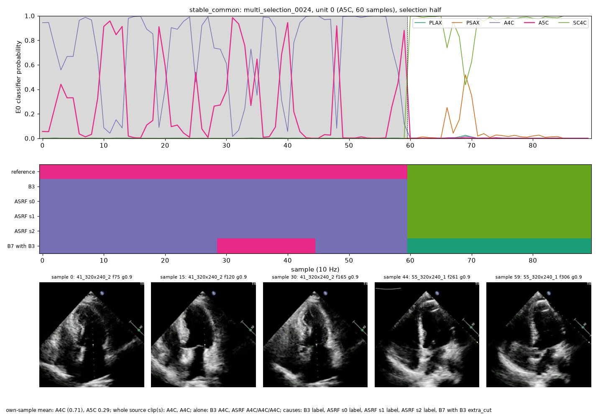
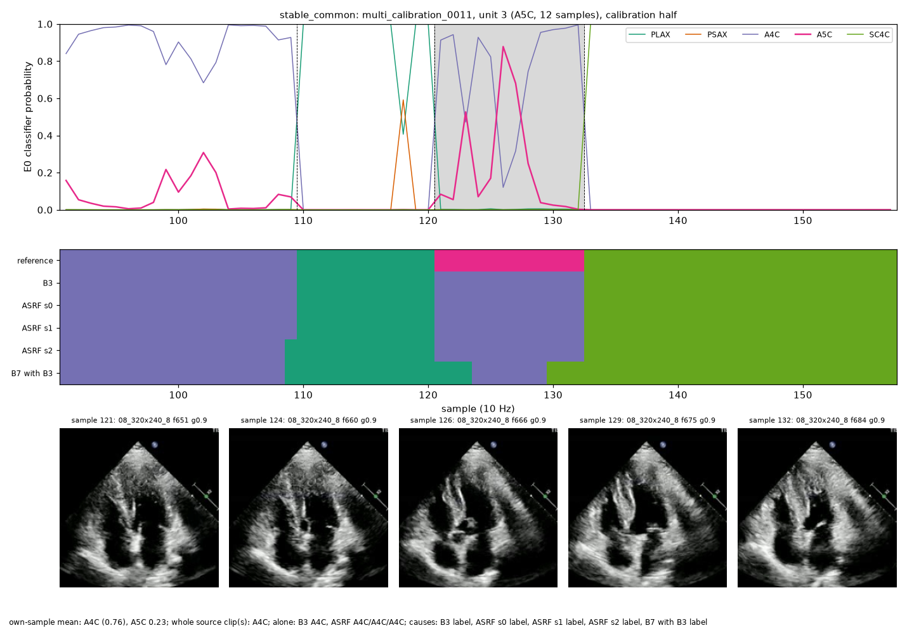
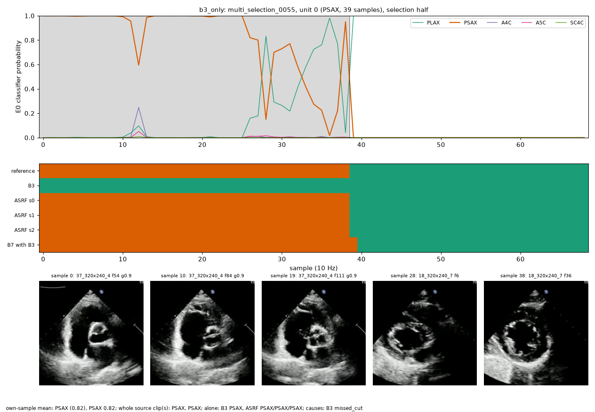
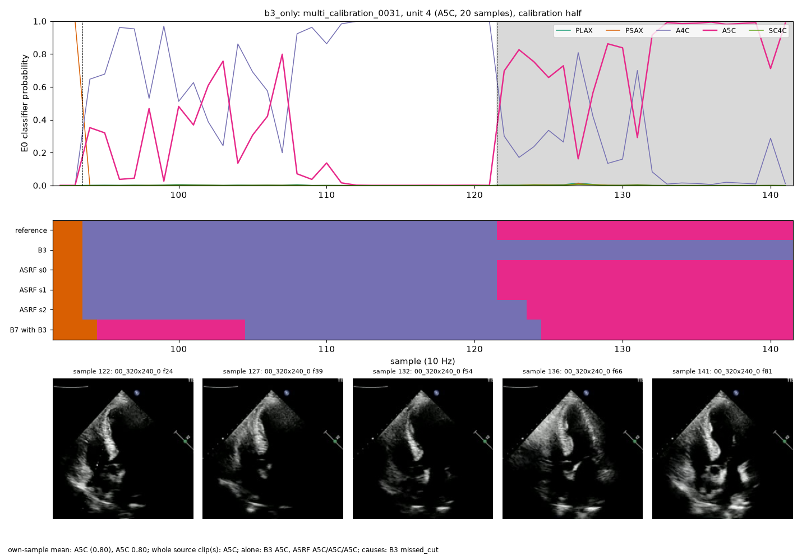
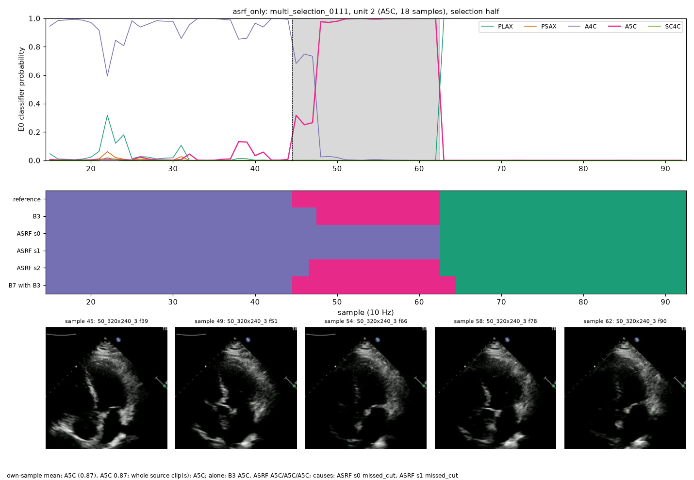
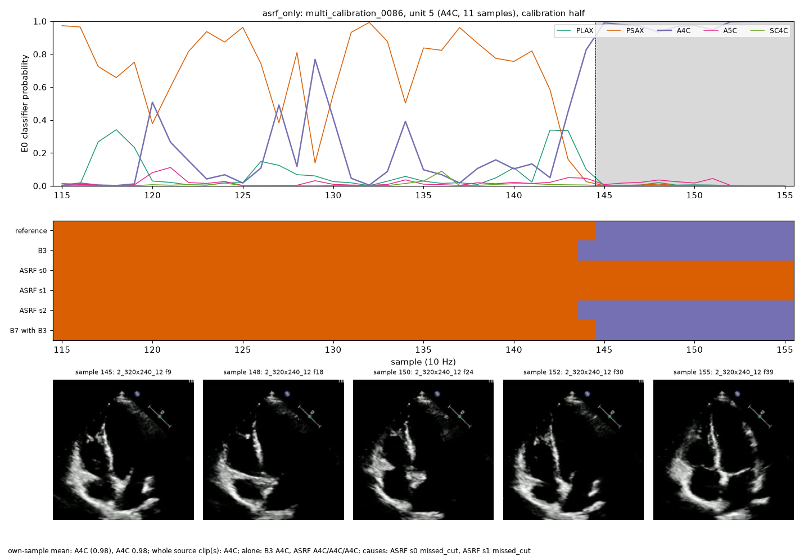
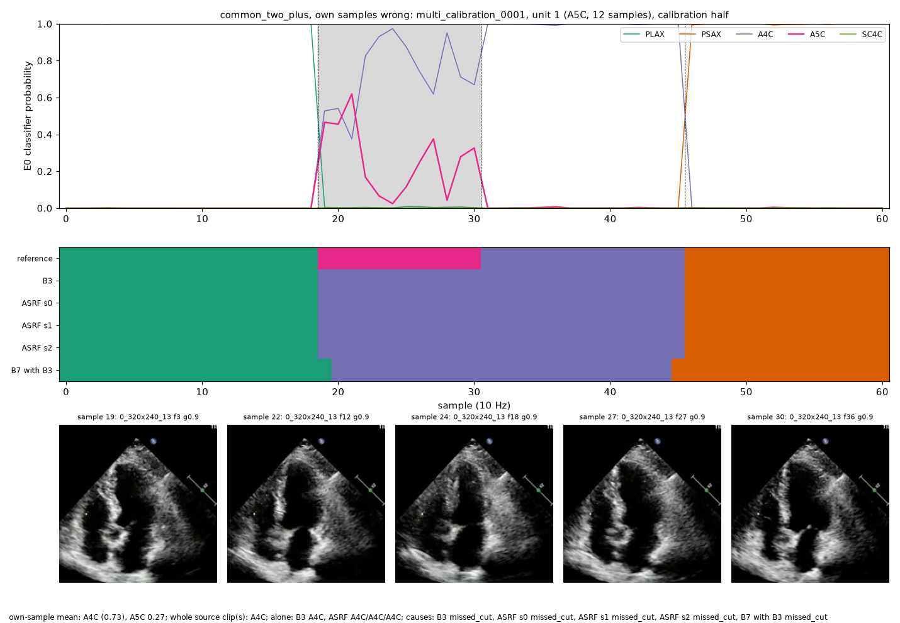

# Representative cases (round 4; diagnostic only; frames from EV9V, CC BY 4.0)

## Case 1: stable_common (label)

own-sample mean: A4C (0.71), A5C 0.29; whole source clip(s): A4C, A4C; alone: B3 A4C, ASRF A4C/A4C/A4C; causes: B3 label, ASRF s0 label, ASRF s1 label, ASRF s2 label, B7 with B3 extra_cut

## Case 2: stable_common (label)

own-sample mean: A4C (0.76), A5C 0.23; whole source clip(s): A4C; alone: B3 A4C, ASRF A4C/A4C/A4C; causes: B3 label, ASRF s0 label, ASRF s1 label, ASRF s2 label, B7 with B3 label

## Case 3: b3_only (missed_cut)

own-sample mean: PSAX (0.82), PSAX 0.82; whole source clip(s): PSAX, PSAX; alone: B3 PSAX, ASRF PSAX/PSAX/PSAX; causes: B3 missed_cut

## Case 4: b3_only (missed_cut)

own-sample mean: A5C (0.80), A5C 0.80; whole source clip(s): A5C; alone: B3 A5C, ASRF A5C/A5C/A5C; causes: B3 missed_cut

## Case 5: asrf_only (missed_cut)

own-sample mean: A5C (0.87), A5C 0.87; whole source clip(s): A5C; alone: B3 A5C, ASRF A5C/A5C/A5C; causes: ASRF s0 missed_cut, ASRF s1 missed_cut

## Case 6: asrf_only (missed_cut)

own-sample mean: A4C (0.98), A4C 0.98; whole source clip(s): A4C; alone: B3 A4C, ASRF A4C/A4C/A4C; causes: ASRF s0 missed_cut, ASRF s1 missed_cut

## Case 7: common_two_plus, own samples wrong (missed_cut)

own-sample mean: A4C (0.73), A5C 0.27; whole source clip(s): A4C; alone: B3 A4C, ASRF A4C/A4C/A4C; causes: B3 missed_cut, ASRF s0 missed_cut, ASRF s1 missed_cut, ASRF s2 missed_cut, B7 with B3 missed_cut
