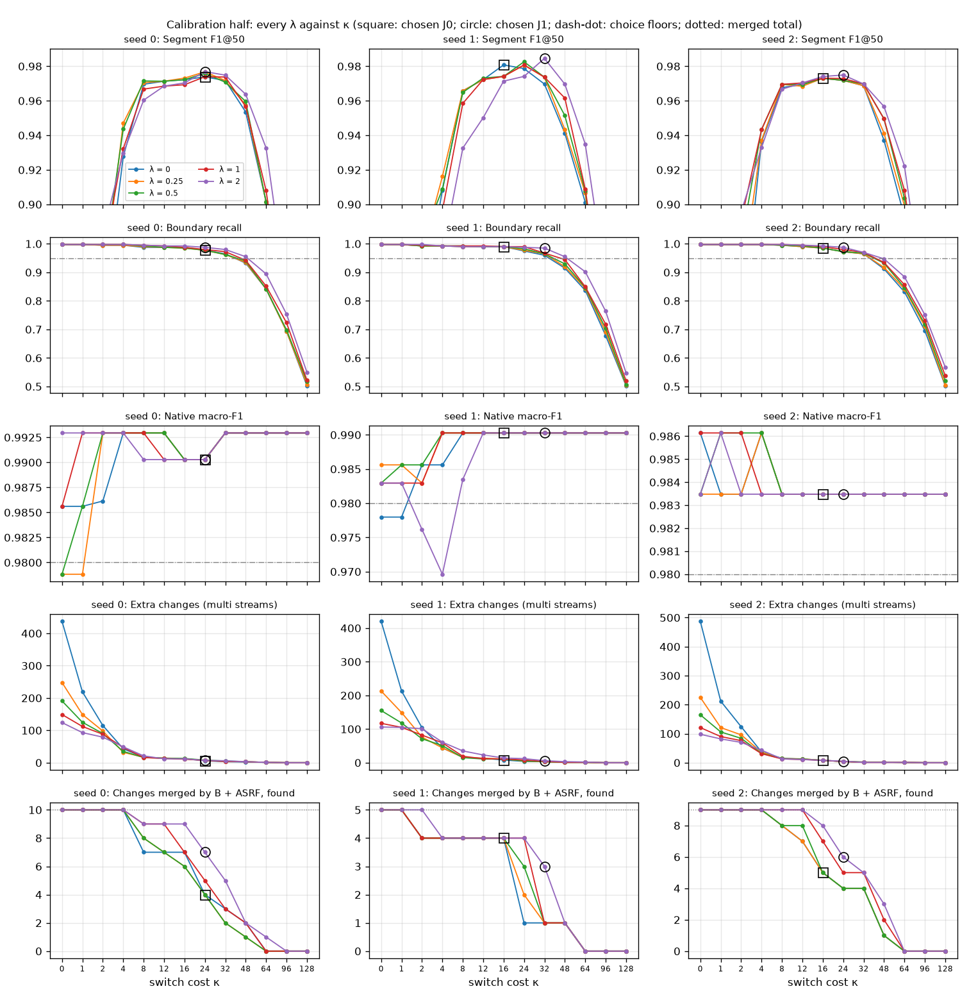

# Joint decoding switch-cost check: κ up to 128 (post hoc, 2026-10-07)

**This is a post-hoc check, not part of the original pre-registration.** The project lead asked for it after seeing
that every J0 and J1 choice of the joint boundary decoding round sat at the largest switch cost of its grid (κ = 8)
while the calibration score was still rising. The original round, its configuration and its negative result are
unchanged (`docs/results/2026-10-07_joint_boundary_decoding/`).

Only the κ range changed, from {0, 1, 2, 4, 8} to {0, 1, 2, 4, 8, 12, 16, 24, 32, 48, 64, 96, 128}. Everything else
was inherited from the original round:
- the exported L1 class probabilities and ASRF boundary probabilities, with no re-extraction;
- the objective, the clipping and tie rules, and the λ values {0, 0.25, 0.5, 1, 2};
- the models, the 224 x 224 input and the data split;
- the calibration choice rule, the comparisons and the goal.

Nothing was trained. The plan is `docs/superpowers/plans/2026-10-07-joint-decoding-kappa-check.md`, the lead's text
with the implementation choices. The configuration and code were committed before the check computed any metric
(2017f01).
Fixes from an independent review followed (46e5411); in between, only a calibration-only dry run with placeholder
settings ran, and it printed no metric. The parameters were chosen on the
calibration half alone and committed (80b81c7) before J0 or J1 decoded any selection sequence. This check is not a new
model.

## Answers

1. **What was done.**
   - For each seed, the 5 x 13 grid was decoded on the calibration half. The 25 settings of the original grid
     reproduced their original calibration metrics exactly.
   - J0 took the best feasible setting with λ = 0, and J1 the best feasible setting of the whole grid, with the
     original rule.
   - The chosen systems were applied once to both halves and compared with their κ ≤ 8 counterparts from the original
     round, L1 + B3, B + ASRF and the references.
2. **Does a higher switch cost remove extra segments first while keeping the recovered true changes?** Partly.
   - On the calibration half, segment F1@50 now peaks inside the range, at κ = 16–32, and declines beyond it, slowly
     at first. At κ = 48 it is 0.94–0.97; at κ = 128 it is 0.66–0.71 and boundary recall 0.50–0.57.
   - Between κ = 8 and the chosen κ, extra changes fall by about half or more, but some recovered changes go too. For
     example, in seed 0 with λ = 0, going from κ = 8 to 24 cuts extra changes from 17 to 6. Of the 10 changes that
     B + ASRF had merged, the number found drops from 7 to 4.
   - With λ = 2, more of those changes survive at the same κ. In seed 0 at κ = 24 it keeps 7 of 10, where λ = 0
     keeps 4.
   - No choice reached the new upper limit of κ = 128 (section 1).
3. **Gains and losses on the selection half, against the κ ≤ 8 choices.**
   - **Extra segments removed.** J1's extra changes fall from 37, 41 and 37 to 14, 13 and 13 (seeds 0, 1, 2). Its
     unmatched predicted segments fall from 65, 72 and 65 to 36, 33 and 39, and its label switches inside native clips
     from 31, 27 and 32 to 5, 3 and 4.
   - **True changes kept.** Of about 372 true view changes that the κ ≤ 8 choice found, J1 keeps 365, 362 and 363. It
     loses 7, 10 and 8, from 12, 15 and 12 recordings; most of them merged.
   - **Recovered changes.** Of the changes that B + ASRF had merged and the κ ≤ 8 choice recovered (12, 7 and 8), J1
     keeps 9, 4 and 4.
   - **True segments swallowed.** J1 loses 8, 10 and 10 reference units that the κ ≤ 8 choice matched, from 8, 9 and 9
     recordings, and newly matches 6, 8 and 3.
   - **Native clips.** J0 and J1 now read all three of the clips that ASRF had changed to wrong in every seed. Against
     B + ASRF, J1 newly misreads 2, 0 and 1 selection clips. Against L1 + B3 it still misreads 2, 0 and 1 more and
     fixes none.
4. **J1 − J0.** No consistent difference was detected. On the selection half the differences are +0.85, +1.23 and
   −0.05 points of segment F1@50; only seed 1's interval excludes zero. Whatever the larger switch cost changes
   therefore cannot be credited to the ASRF boundary term. No gain over the original round is established either
   (section 3).
5. **Against L1 + B3, the references and the goal.**
   - **J1 − (L1 + B3).** No consistent difference was detected: +1.89, +2.06 and +0.46 points on the selection half,
     with only seed 1's interval above zero.
   - **J0 − (L1 + B3).** No consistent difference was detected: +1.04, +0.84 and +0.51, with every interval containing
     zero.
   - **J1 − (E0 + B3).** On the selection half it is −0.7, −0.8 and −1.7 points. Every interval now contains zero,
     where the κ ≤ 8 choice was below E0 + B3 in every seed.
   - **Goal.** J1 averages 0.924 segment F1@50 on the selection half and 0.979 on the calibration half; the goal
     requires 0.944 and 0.982.
     - Its selection native macro-F1 in seed 0 (0.970) is below the 0.973 floor.
     - Its selection boundary recall in seed 1 (0.948) is below 0.95.
     - J0 averages 0.917 / 0.976 and misses too.

Under the decision table fixed before the check, neither J0 nor J1 improves (neither is stably better than L1 + B3),
so the decoding search on these fixed outputs ends. As the plan requires, the range is not extended again.

## Terms

The definitions are those of the original round's README. In brief:
- **Points** are hundredths of a metric.
- **Extra changes** are unmatched final changes more than 5 samples from every true change.
- **Recovered changes** are true view changes that B + ASRF merged although an ASRF candidate cut lay within 5
  samples, and that the κ ≤ 8 choice found.
- **Swallowed units** are reference units matched by the κ ≤ 8 choice and no longer matched.
- **Consistent** means that all three seeds' 95% intervals exclude zero in the same direction on a half.
- **Stably better** is the original round's rule: every seed's selection interval for segment F1@50 lies above zero,
  and no seed's calibration interval lies below zero.
- The **κ ≤ 8 choices** are J0 and J1 as chosen in the original round. Their stored predictions reproduce their
  original rows exactly.

## 1. Choices and curves on the calibration half

| Seed | J0 | J1 | Qualifying settings (J0 / J1) | Calibration segment F1@50 (J0 / J1) |
|---|---|---|---|---|
| 0 | κ = 24 | λ = 2, κ = 24 | 9 of 13 / 43 of 65 | 0.974 / 0.977 |
| 1 | κ = 16 | λ = 2, κ = 32 | 7 of 13 / 42 of 65 | 0.981 / 0.985 |
| 2 | κ = 16 | λ = 2, κ = 24 | 9 of 13 / 45 of 65 | 0.973 / 0.975 |

**κ curves.** `kappa_curves.png` shows, for every λ, how segment F1@50, boundary recall, native macro-F1, extra
changes and the recovered merged changes move with κ. Its segment F1@50 axis starts at 0.90, so the lowest values lie
off the plotted range.
- **Extra changes.** With λ = 0 they fall from 437, 420 and 487 at κ = 0 to 0 at κ = 96.
- **Segment F1@50.** It peaks at κ = 16–32 in every seed and falls to 0.66–0.71 at κ = 128.
- **Boundary recall.** It stays at or above 0.95 through κ = 32 in every curve, and through κ = 48 only for λ = 2 in
  seeds 0 and 1. It then declines to 0.50–0.57 at κ = 128.
- **Native macro-F1.** It stays between 0.97 and 0.993 throughout.

**Range limits.**
- **κ.** No choice sits at κ = 128, so this range brackets the best switch cost for every seed and system on the
  calibration half.
- **λ.** Every J1 choice sits at the largest λ (2). The plan keeps λ fixed, so larger values were not tried. No global
  optimum is claimed.

## 2. Results per system

Each cell gives the selection half / the calibration half.

| System | Segment F1@50 | Boundary P | Boundary R | Native macro-F1 | Cuts per clip | A5C right |
|---|---|---|---|---|---|---|
| J1 s0 | 0.927 / 0.977 | 0.963 / 0.983 | 0.961 / 0.987 | 0.970 / 0.990 | 0.018 / 0.030 | 11/11 / 18/18 |
| J1 s1 | 0.927 / 0.985 | 0.965 / 0.985 | 0.948 / 0.985 | 0.989 / 0.990 | 0.011 / 0.021 | 11/11 / 18/18 |
| J1 s2 | 0.917 / 0.975 | 0.966 / 0.987 | 0.953 / 0.987 | 0.979 / 0.983 | 0.014 / 0.021 | 11/11 / 18/18 |
| J0 s0 | 0.919 / 0.974 | 0.965 / 0.985 | 0.948 / 0.977 | 0.970 / 0.990 | 0.011 / 0.025 | 11/11 / 18/18 |
| J0 s1 | 0.915 / 0.981 | 0.948 / 0.980 | 0.953 / 0.990 | 0.989 / 0.990 | 0.018 / 0.034 | 11/11 / 18/18 |
| J0 s2 | 0.917 / 0.973 | 0.956 / 0.980 | 0.958 / 0.985 | 0.979 / 0.983 | 0.028 / 0.034 | 11/11 / 18/18 |
| J1 (κ ≤ 8) s0, s1, s2 | 0.903, 0.894, 0.901 / 0.971, 0.966, 0.970 | 0.903, 0.894, 0.905 / … | 0.974, 0.974, 0.971 / … | 0.970, 0.978, 0.968 / … | 0.109, 0.095, 0.113 / … | 11, 10, 10 of 11 / … |
| L1 + B3 s0, s1, s2 | 0.908, 0.906, 0.912 / 0.971, 0.968, 0.969 | 0.961, 0.970, 0.961 / … | 0.961, 0.937, 0.961 / … | 0.989 in each / … | 0.095, 0.007, 0.092 / … | 11 of 11 in each / … |
| B + ASRF s0, s1, s2 | 0.902, 0.907, 0.896 / 0.978, 0.978, 0.973 | 0.945, 0.938, 0.928 / … | 0.940, 0.948, 0.950 / … | 0.957 in each / … | 0.035, 0.021, 0.014 / … | 9 of 11 in each / … |

**Means of segment F1@50.**
- J1: 0.924 / 0.979.
- J0: 0.917 / 0.976.
- J1 (κ ≤ 8): 0.899 / 0.969.
- L1 + B3: 0.909 / 0.969.
- B + ASRF: 0.902 / 0.976.
- E0 + B3: 0.934 / 0.934.
- B7 + B3: 0.880 / 0.972.

## 3. Paired contrasts of segment F1@50

Point differences with 95% paired-bootstrap intervals (2,000 draws, seed 20261002). Native clips are resampled by
session and streams by stream.

| Contrast | Half | Seed 0 | Seed 1 | Seed 2 |
|---|---|---|---|---|
| J1 − J0 | selection | +0.85 [0.00, +2.01] | +1.23 [+0.18, +2.52] | −0.05 [−0.97, +0.79] |
| J1 − J0 | calibration | +0.30 [−0.41, +1.25] | +0.38 [−0.60, +1.60] | +0.19 [0.00, +0.59] |
| J1 − (L1 + B3) | selection | +1.89 [−0.08, +3.95] | +2.06 [+0.35, +3.96] | +0.46 [−1.33, +2.22] |
| J1 − (L1 + B3) | calibration | +0.58 [−0.48, +1.61] | +1.68 [+0.31, +3.20] | +0.56 [−0.61, +1.61] |
| J0 − (L1 + B3) | selection | +1.04 [−0.94, +3.05] | +0.84 [−0.84, +2.69] | +0.51 [−1.16, +2.25] |
| J1 − (B + ASRF) | selection | +2.50 [+0.41, +4.68] | +2.00 [+0.16, +3.84] | +2.06 [−0.13, +4.12] |
| J0 − J0 (κ ≤ 8) | selection | +1.46 [−0.67, +3.62] | +2.05 [−0.11, +4.24] | +1.89 [+0.31, +3.57] |
| J1 − J1 (κ ≤ 8) | selection | +2.39 [+0.26, +4.51] | +3.28 [+0.92, +5.75] | +1.58 [−0.45, +3.56] |
| J1 − (E0 + B3) | selection | −0.72 [−3.49, +2.16] | −0.76 [−3.06, +1.52] | −1.75 [−4.38, +0.84] |
| J1 − (B7 + B3) | calibration | +0.47 [−0.69, +1.78] | +1.24 [−0.28, +2.98] | +0.28 [−1.00, +1.70] |

- **Consistency.** None of the contrasts against J0, L1 + B3, B + ASRF or the κ ≤ 8 choices is consistent.
  J1 − (B + ASRF) and J1 − J1 (κ ≤ 8) come closest, with two of three selection intervals above zero.
- **Against the references on their weaker halves.** J1 is consistently above B7 + B3 on the selection half (+4.74,
  +4.69 and +3.71 points) and above E0 + B3 on the calibration half (+4.29, +5.06 and +4.09). These two references
  score 0.880 and 0.934 there; the goal compares J1 with E0 + B3 on the selection half and B7 + B3 on the calibration
  half.
- **Native macro-F1.** On the selection half, J1 − (L1 + B3) is −1.90 and −0.99 points in seeds 0 and 2, with
  intervals that reach zero only at their upper end, and 0.00 in seed 1.

## 4. Gains and losses against the κ ≤ 8 choices (selection half)

| | J1 (s0, s1, s2) | J0 (s0, s1, s2) |
|---|---|---|
| True changes found by the κ ≤ 8 choice | 372, 372, 371 | 372, 372, 371 |
| Still found | 365, 362, 363 | 362, 364, 366 |
| Lost (recordings) | 7, 10, 8 (12, 15, 12) | 10, 8, 5 (15, 12, 7) |
| Found only now | 2, 0, 1 | 0, 0, 0 |
| Recovered changes kept | 9 of 12, 4 of 7, 4 of 8 | 7 of 12, 4 of 7, 5 of 8 |
| Extra changes | 37 → 14, 41 → 13, 37 → 13 | 35 → 13, 41 → 20, 39 → 17 |
| Unmatched predicted segments | 65 → 36, 72 → 33, 65 → 39 | 64 → 37, 72 → 44, 68 → 42 |
| Label switches inside native clips | 31 → 5, 27 → 3, 32 → 4 | 30 → 3, 27 → 5, 34 → 8 |
| Reference units newly matched / swallowed | 6 / 8, 8 / 10, 3 / 10 | 3 / 12, 6 / 10, 2 / 6 |

- **Lost changes.** Most of the lost true changes became merged (an ASRF candidate nearby, but no final change). In
  J1 these are 5, 7 and 8; the rest are displaced or have no candidate.
- **Correct visual evidence lost.** These are fragments the L1 head reads correctly that sit in unmatched units.
  - J1: 23, 23 and 28 fragments from 20, 19 and 23 recordings.
  - J1 (κ ≤ 8): 20, 22 and 20 from 17 each.
  - L1 + B3: 32, 38 and 29 from 24, 29 and 23.
- **Unmatched units, J1, selection.** J1 leaves 37, 40 and 44 units unmatched. Of these, 21, 20 and 23 have a wrong
  label, 15, 20 and 20 a missed cut, and 1, 0 and 1 an extra cut.

## 5. Native clips

- **The three clips.** These are the three selection clips that B + ASRF read as the wrong one of A4C and A5C in
  every seed, while L1 + B3 read them correctly. J0 and J1 now read all three in every seed; the κ ≤ 8 choices read
  3, 2 and 2.
- **Selection half.** J1 is shown against each comparator as fixed / new clips, with each changed clip from its own
  session.

  | J1 against | Seed 0 | Seed 1 | Seed 2 |
  |---|---|---|---|
  | B + ASRF | 3 / 2 | 3 / 0 | 3 / 1 |
  | L1 + B3 | 0 / 2 | 0 / 0 | 0 / 1 |
  | J1 (κ ≤ 8) | 1 / 1 | 1 / 0 | 2 / 1 |

- **Calibration half.** Against B + ASRF, J1 fixes 0, 0 and 1 clips and newly misreads 1, 1 and 1. Against L1 + B3 it
  fixes 1, 0 and 0 and newly misreads 1, 0 and 0.

## 6. Goal

| | Required | J1 | J0 |
|---|---|---|---|
| Mean segment F1@50, selection | ≥ 0.944 | 0.924 (−2.1 points) | 0.917 |
| Mean segment F1@50, calibration | ≥ 0.982 | 0.979 (−0.3 points) | 0.976 |
| Native macro-F1 per seed, selection | ≥ 0.973 | 0.970, 0.989, 0.979 | 0.970, 0.989, 0.979 |
| Native macro-F1 per seed, calibration | ≥ 0.980 | 0.990, 0.990, 0.983 | 0.990, 0.990, 0.983 |
| Boundary recall per seed, selection | ≥ 0.95 | 0.961, 0.948, 0.953 | 0.948, 0.953, 0.958 |
| Boundary recall per seed, calibration | ≥ 0.95 | 0.987, 0.985, 0.987 | 0.977, 0.990, 0.985 |

- J1 misses both mean scores, the selection native floor in seed 0 and the selection recall floor in seed 1.
- With the calibration sensitivity bar of 0.984, J1 is 0.5 points short.

## 7. Decision under the fixed table

| Question | Outcome |
|---|---|
| Is J0 stably better than L1 + B3? | No |
| Is J1 stably better than L1 + B3? | No |
| Is J1 stably better than J0? | No |
| Goal met by J0 or J1? | No |

The table's case is "neither improves": the decoding search on these fixed outputs ends. A stronger simple baseline
is not established, because J0 is not stably better than L1 + B3. Under the plan, the range is not extended again.

**What the check adds.**
- **The κ ≤ 8 grid was too narrow.** A larger switch cost removes most of the over-segmentation.
  - It raises selection segment F1@50 by +1.5 to +3.3 points over the κ ≤ 8 choices, but only some of those intervals
    exclude zero.
  - It brings the point estimates above L1 + B3 in every seed (+0.5 to +2.1 points for J1).
- **Without a stable gain.** None of these differences is stable under the round's rule.
- **The boundary term earns no credit.** J1 − J0 is not consistent either.
- These are observations on a twice-used development set, not a gain.

## 8. What this does not show

- **That larger λ would not help.** Every J1 choice sat at λ = 2, the largest value, and the plan kept λ fixed.
- **That J1 and J0, or J1 and L1 + B3, are equal.** Most of their intervals contain zero, which is not evidence of
  equality. The few that exclude zero, all in seed 1, do not make a consistent difference.
- **That the result transfers.** Both validation halves have been used repeatedly, calibration scores are optimistic
  after the choice, constructed streams reuse recordings, and the three seeds share one validation set.
- **Why some recovered changes are lost.** A larger switch cost joins short runs, including some correct ones. This
  check does not separate the two.

## 9. Cost

- **Choice.** The 65-setting grid with its curves on the calibration half for three seeds took about 20 seconds on
  the CPU.
- **Evaluation.** Both halves, all systems, references and diagnostics took about 5.5 minutes.

## Files

- `summary.json` holds every system's rows, the choices and range flags, the contrasts, the gains and losses, the
  diagnostics, the stable rule, the goals, the decision and the references. It contains no recording ids.
- `report_tables.md` holds the generated tables.
- `choices.json` holds the 5 x 13 calibration grid of every seed with its curve values and the choices. It was
  committed before J0 or J1 decoded the selection half.
- `kappa_curves.png` draws the calibration curves from `choices.json` (`scripts/joint_decoding_kappa.py --plot`).
- Per-sequence predictions and per-recording details stay on the server, in `runs/joint_boundary_decoding_kappa_v1/`.
