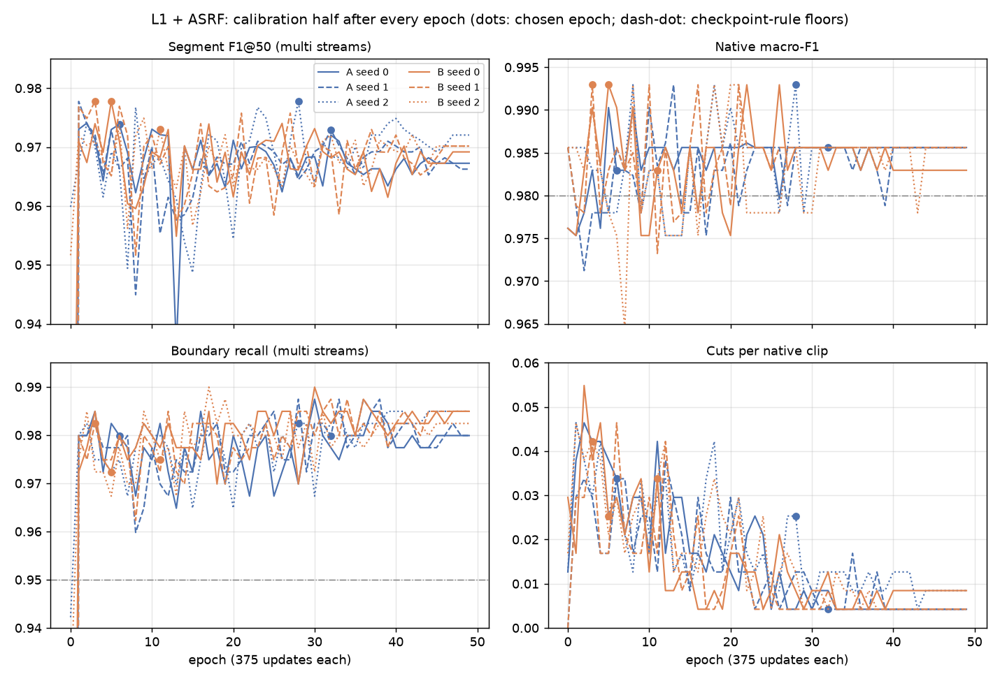

# L1 + ASRF: ASRF on frozen E1 and L1 features, two arms x three seeds (2026-10-07)

This round asked whether ASRF trained on the L1 visual features improves the full system. L1 is the fan224 round's
legacy-input model whose last ViT block was adapted. The two arms differ only in the frozen features that ASRF reads.

| Arm | Features (frozen) | ASRF |
|---|---|---|
| A (matched control) | E1, the frozen EchoViewCLIP image encoder of earlier rounds | retrained here, seeds 0, 1, 2 |
| B (candidate) | L1_s0, L1_s1, L1_s2 from the fan224 round, one per seed | retrained here, seeds 0, 1, 2 |

B was the pre-specified candidate. The plan is `docs/superpowers/plans/2026-10-07-l1-asrf-integration.md`. The round
checks a combination of existing components; it is not a new method. The configuration, code, tests and a pre-training
record were committed before any training metric existed (286bc34). Only EV9V training recordings entered training.
Each run's checkpoint was chosen on the calibration half alone, and the selection half was read only after all six
runs had ended. The test split and EchoNet-Pediatric were not read, and the public labels are unchanged.

## Answers

1. **What was done.**
   - **Inputs.** B reads one new feature cache per L1 seed. A reads the verified E1 cache. Within a seed, A and B see
     the same training streams, native windows and validation sequences, and only the features differ (section 1).
   - **Training.** Six runs of the official ASRF, 50 epochs each, with no early stopping. A and B of a seed share one
     saved initial state and one saved batch plan. All six runs finished, and each has an epoch that meets the
     checkpoint rule on the calibration half (section 2).
   - **Evaluation.** The chosen checkpoints decode both halves with the official post-processing. The main contrast
     is B − A, and the secondary one is B − (L1 + B3), where L1 + B3 is the fan224 round's result reproduced exactly.
     The diagnostics fixed in the report script answer the three questions below (sections 3–7).
2. **Do recordings that are read correctly stay correct as short stream fragments?** Mostly yes, at the level of the
   visual head.
   - With the frozen L1 head and the majority rule, 17, 8 and 27 of about 700–720 selection fragments from correctly
     read recordings are read wrong as fragments (seeds 0, 1, 2). They come from only 4, 3 and 6 of the 231 source
     recordings.
   - On the calibration half it is 5, 5 and 8 fragments, from 2, 2 and 4 recordings. The mean-probability rule gives
     the same picture.
   - The full system loses more than this. Among fragments that are right both as a fragment and as a whole
     recording, B + ASRF leaves 34, 27 and 34 of about 690 selection fragments in units it does not match. They come
     from 26, 23 and 26 recordings. For L1 + B3 the counts are 32, 38 and 29 fragments, from 24, 29 and 23
     recordings.
3. **Is the remaining loss mainly class errors, missed cuts or extra cuts?** Mainly class errors.
   - **Wrong labels.** On the selection half B + ASRF leaves 50, 45 and 48 of 502 reference units unmatched. A wrong
     label is the most common cause (30, 27 and 29 units), ahead of missed cuts (20, 18 and 18). Extra cuts and
     shifted boundaries almost never cause an unmatched unit (0–1 per seed).
   - **Missed changes.** B misses 23, 20 and 19 true view changes. Half or more of them had a candidate cut within 5
     samples that the class vote then merged (14, 10 and 13). Fewer had no candidate (7, 6 and 5) or a displaced one
     (2, 4 and 1). A further 42, 35 and 37 changes were found with a wrong view on one side.
   - **Extra cuts.** B makes 21, 20 and 27 extra label changes on the selection streams. They cost precision, but
     they rarely unmatch a unit.
   - **Calibration half.** The same order holds there with smaller counts. B leaves 13, 11 and 14 units unmatched,
     and 7, 6 and 10 of them have a wrong label.
   - The loss is therefore not a pure segmentation problem. The labels, including the class vote that merges two
     views across a proposed cut, carry most of it. The unit causes are checked in a fixed order with the label
     first, so the label share includes some units whose edge was also missed (section 6).
4. **Does L1 + ASRF beat the matched control and L1 + B3, and reach the goal?** No.
   - **B − A.** No consistent difference was detected on either half. Segment F1@50 changes by −0.4, +3.0 and +0.4
     points on the selection half and by +0.4, +0.5 and −0.5 on the calibration half. Only the seed 1 selection
     interval lies above zero.
   - **B − (L1 + B3).** No consistent difference was detected in segment F1@50 (−0.6, +0.1 and −1.6 points on the
     selection half; +0.7, +1.0 and +0.4 on the calibration half, all intervals containing zero).
   - **Goal.** B averages 0.902 segment F1@50 on the selection half and 0.976 on the calibration half; the goal
     requires 0.944 and 0.982. B's selection native macro-F1 is 0.957 in every seed, below the 0.973 floor. Its
     selection boundary recall is 0.940 and 0.948 in seeds 0 and 1, below 0.95.
5. **Does ASRF keep L1's recognition?** Not on the selection half.
   - In every seed, B misreads the same three selection native clips that L1 + B3 reads correctly, and it fixes none.
     One is A4C read as A5C, and two are A5C read as A4C. B reads 9 of 11 A5C clips against 11 of 11 for L1 + B3.
   - Against the frozen L1 head's own majority vote, B gets 3, 2 and 3 selection clips wrong that the head reads
     correctly, and none the other way. In seeds 0 and 2 these are the three clips that B loses against L1 + B3. In
     seed 1 they are two of them, and the head misreads the third.
   - On the calibration half B is level with or slightly ahead of L1 + B3. It fixes one clip in each seed and loses
     one in seed 2.

Under the plan, no stable gain was detected, so this combination ends here. No encoder fine-tuning, ASRF loss change,
output-head replacement or larger budget was started.

## Terms

- **Points** are hundredths of a metric; −0.4 points of segment F1@50 means −0.004.
- **Native clips** are whole single-view recordings. A clip is read correctly when the majority of its samples is.
- **Cuts per clip** count additional label switches within clips assigned a single reference label.
- **Constructed streams** join fragments of several validation recordings. A **reference unit** is a stretch of one
  view between two true view changes. A unit can be made of fragments from more than one recording.
- A unit is **matched** when a predicted segment of its class overlaps it with IoU of at least 0.5 under the matching
  of segment F1@50. An unmatched unit gets the first cause that applies. A **wrong label** means that a segment of
  another class covers it at IoU 0.5 or more. A **missed cut** means that one of its edges has no predicted change
  within 10 samples. An **extra cut** means that an unmatched predicted change lies inside it. Everything else is a
  **shifted boundary**.
- **Consistent** means that all three seeds' 95% intervals exclude zero in the same direction on a half. An interval
  that contains zero does not mean the systems are equal.

## 1. Inputs (Task 1)

- **A** reads the verified E1 cache (key 16efc85be645). On fixed training frames, the E1 encoder recomputed online
  matches the export reference to 2.9 x 10⁻⁶. It matches the stored fp16 cache to 9.7 x 10⁻⁴. The limits are 10⁻³
  and 2 x 10⁻².
- **B** reads one new cache per L1 seed (keys ebe798a624df, 49ef2810d941 and e83275fd433d).
  - Training recordings come from the fan224 round's training export, with the fp16 features as exported. The time
    stamps are copied from the E1 cache, and the frame indices match it.
  - The 521 validation recordings were extracted again with the frozen L1 weights through the legacy input.
  - Each sample's logits are the L1 head applied to the stored fp16 feature, and its probabilities are their softmax.
    They differ from the exported probabilities by at most 1.75 x 10⁻⁴.
  - The online L1 encoder matches the stored export to within 1.94 x 10⁻³ on fixed training frames, in both contrast
    variants.
- **Alignment.** Both arms use the same protocol, the same 1,500 training-stream recipes (digest checked) and the
  same validation banks.
  - For every seed, all 1,500 training streams and all validation streams have the same sources, labels, joins and
    lengths in A and B. Only the features differ.
  - Frame indices and time stamps agree for all 3,885 recordings in both variants.
  - Each new index keeps the E1 row order, because the training bank is built in index order.

## 2. Training (Task 2)

**Recipe** (identical for both arms).
- The model is the official ASRF at commit 9623f1e8. It has 512 input channels, five classes, 64 features, 10 layers
  and 4 stages per branch.
- The loss is the official one. It combines cross-entropy, the Gaussian-similarity smoothing term (0.15) and the
  boundary loss with weight 0.1. Decoding uses the official refinement with boundaries at threshold 0.5.
- **Note added 2026-10-08.** The weight 0.15 above, and the same text in `configs/experiments/l1_asrf_integration_v1.yaml`,
  is a recording error. The official `train.py` passes `gstmse_weight=True`, and the project's `ASRFHead` copies it, so
  the Gaussian-similarity term entered every ASRF run at weight 1. The 0.15 is the weight of the plain smoothing term,
  which is off. The code and the trained models are unchanged, and no result here changes.
- Each update reads 4 constructed training streams and 4 native windows of at most 256 samples. One epoch is 375
  updates, which cover the 1,500 training streams in a new order plus 1,500 native windows.
- Training runs 50 epochs (18,750 updates) with no early stopping.
- The optimiser is AdamW with lr 3 x 10⁻⁴, weight decay 10⁻⁴ and gradient clip 1.0. The learning rate warms up over
  2 epochs, then follows a cosine to 0.
- Training runs in fp32 with TF32 off and deterministic cuDNN.
- The visual encoders stay frozen, and ASRF has no path to their weights.

**Pairing within a seed.**
- A and B of a seed load one saved ASRF initial state and follow one saved batch plan. The plan stores the identity of
  every update (sequence ids, lengths, labels and joins), and each epoch's batches were checked against it.
- The class weights and the boundary pos_weight follow the official rules on the seed's epoch-0 labels, so A and B
  share them. The pos_weight is 35.4, 35.0 and 34.8 for seeds 0, 1 and 2.
- The random state that drives ASRF's dropout is seeded right before the first update.
- The three pairs vary the L1 training seed and the ASRF seed together, so the spread over seeds mixes both sources.

**Checkpoint rule.**
- After every epoch the model decodes the calibration half only.
- An epoch qualifies when its calibration native macro-F1 is at least 0.980 and its multi-stream boundary recall is
  at least 0.95. Among qualifying epochs, the highest segment F1@50 wins. Ties go to fewer cuts per clip, then to the
  earlier epoch.
- Without a qualifying epoch, the final epoch would be shown as a diagnostic and could not pass the goal. This did not
  happen.
- The historical E1 + ASRF runs chose their epoch on the selection half with early stopping. That is why A was
  retrained under the same rule as B.
- Calibration scores are optimistic after the choice and are not an independent confirmation.

**Smoke checks** (seed 0, both arms, committed code).
- Two runs of 6 updates from the same state agree to within 3.6 x 10⁻⁷ in loss and 8.4 x 10⁻⁸ in the parameters. They
  are close but not bit-identical.
- Resuming after 3 updates reproduces the uninterrupted run to 7.5 x 10⁻⁹.
- Changing the labels at padded positions leaves the loss unchanged. All 310 parameter tensors receive finite,
  non-zero gradients.
- The training entry cannot load the selection half.

**Runs.** All six finished without a failure or a resume.

| Run | Chosen epoch | Qualifying epochs | Minutes | Final training loss |
|---|---|---|---|---|
| A_s0 | 6 | 45 of 50 | 26.2 | 0.020 |
| B_s0 | 5 | 42 of 50 | 27.4 | 0.015 |
| A_s1 | 32 | 37 of 50 | 27.0 | 0.021 |
| B_s1 | 3 | 40 of 50 | 26.3 | 0.018 |
| A_s2 | 28 | 40 of 50 | 26.2 | 0.023 |
| B_s2 | 11 | 33 of 50 | 26.3 | 0.017 |

**Training curves** (`training_curves.png`; epoch 0 and a few single dips lie below the plotted range).
- The training loss, which the figure does not show, falls from about 1.1 to about 0.02 over 50 epochs.
- **Calibration segment F1@50.** It reaches about 0.97 within 1–3 epochs and then stays between 0.936 and 0.978.
  - In five runs the mean over epochs 25–49 is 0.1–0.5 points above the mean over epochs 5–24. The largest drift is
    A_s2's; in A_s0 the later mean is 0.05 points lower.
  - Over the last ten epochs it averages 0.967–0.972 in every run, with A and B overlapping.
- **Other calibration metrics.** Native macro-F1 varies between 0.973 and 0.993 after epoch 10. Cuts per native clip
  fall from about 0.04 in the early epochs to 0.004–0.009 at the end.
- The chosen epochs score 0.3–0.9 points above the median qualifying epoch of their run. B's choices fell early
  (epochs 5, 3 and 11) and two of A's late (6, 32 and 28). The curves of A and B overlap, so the timing of the choices
  is not read as a difference between the arms.

## 3. Results per system

Each row gives the selection half / the calibration half. L1 + B3 is the fan224 round's result, reproduced from its
stored probabilities and calibration-chosen parameters to within 10⁻¹² on five metrics.

| System | Segment F1@50 | Boundary P | Boundary R | Native macro-F1 | Cuts per clip | A5C right |
|---|---|---|---|---|---|---|
| A_s0 + ASRF | 0.906 / 0.974 | 0.949 / 0.987 | 0.935 / 0.980 | 0.948 / 0.983 | 0.014 / 0.034 | 9/11 / 17/18 |
| A_s1 + ASRF | 0.877 / 0.973 | 0.918 / 0.985 | 0.932 / 0.980 | 0.940 / 0.986 | 0.007 / 0.004 | 7/11 / 17/18 |
| A_s2 + ASRF | 0.892 / 0.978 | 0.923 / 0.985 | 0.940 / 0.982 | 0.957 / 0.993 | 0.014 / 0.025 | 9/11 / 18/18 |
| B_s0 + ASRF | 0.902 / 0.978 | 0.945 / 0.980 | 0.940 / 0.972 | 0.957 / 0.993 | 0.035 / 0.025 | 9/11 / 18/18 |
| B_s1 + ASRF | 0.907 / 0.978 | 0.938 / 0.980 | 0.948 / 0.982 | 0.957 / 0.993 | 0.021 / 0.042 | 9/11 / 18/18 |
| B_s2 + ASRF | 0.896 / 0.973 | 0.928 / 0.975 | 0.950 / 0.975 | 0.957 / 0.983 | 0.014 / 0.034 | 9/11 / 17/18 |
| L1_s0 + B3 | 0.908 / 0.971 | 0.961 / 0.973 | 0.961 / 0.977 | 0.989 / 0.986 | 0.095 / 0.101 | 11/11 / 17/18 |
| L1_s1 + B3 | 0.906 / 0.968 | 0.970 / 0.995 | 0.937 / 0.962 | 0.989 / 0.990 | 0.007 / 0.021 | 11/11 / 18/18 |
| L1_s2 + B3 | 0.912 / 0.969 | 0.961 / 0.968 | 0.961 / 0.982 | 0.989 / 0.983 | 0.092 / 0.131 | 11/11 / 18/18 |

**Means of segment F1@50.**
- A + ASRF: 0.892 / 0.975.
- B + ASRF: 0.902 / 0.976.
- L1 + B3: 0.909 / 0.969.

**Native clips.**
- On the selection half B reads PLAX 104/105, PSAX 68/68, A4C 86/87, A5C 9/11 and SC4C 12/13 in every seed. L1 + B3
  reads A4C 87/87 and A5C 11/11 and is otherwise the same.
- On the calibration half B misreads one to three of 237 clips (one A4C in every seed, plus one PSAX and one A5C in
  seed 2).

**References** (reproduced from their frozen outputs). The historical E1 + ASRF runs trained with early stopping and
chose their epoch on the selection half.

| System | Segment F1@50 | Boundary R | Native macro-F1 |
|---|---|---|---|
| E0 + B3 | 0.934 / 0.934 | 0.961 / 0.955 | 0.965 / 0.966 |
| E1 + B3 | 0.894 / 0.959 | 0.955 / 0.977 | 0.978 / 0.986 |
| B7 + B3 | 0.880 / 0.972 | 0.955 / 0.975 | 0.957 / 0.993 |
| E1 + ASRF s0 (historical) | 0.910 / 0.976 | 0.942 / 0.977 | 0.948 / 0.993 |
| E1 + ASRF s1 (historical) | 0.909 / 0.964 | 0.950 / 0.972 | 0.966 / 0.975 |
| E1 + ASRF s2 (historical) | 0.907 / 0.964 | 0.953 / 0.977 | 0.966 / 0.975 |

The retrained A differs from the historical runs in more than the half used for the choice. It has no early
stopping, runs a fixed 50 epochs, and starts from a new initial state and batch plan. It is 0.4–3.2 points lower
than the historical runs on the selection half. On the calibration half it ranges from 0.2 points lower to 1.3
points higher. This round does not separate these factors. B + ASRF does not reach E0 + B3 on the selection half
(0.934).

## 4. Paired contrasts

Values are point differences with 95% paired-bootstrap intervals (2,000 draws, seed 20261002). Native clips are
resampled by session and streams by stream.

**B − A (main contrast).**

| Seed | Half | Segment F1@50 | Boundary recall | Native macro-F1 | Native clips fixed / new |
|---|---|---|---|---|---|
| 0 | selection | −0.36 [−1.86, +1.16] | +0.52 [−0.52, +1.57] | +0.90 [0.00, +2.85] | 1 / 0 |
| 0 | calibration | +0.39 [−0.68, +1.41] | −0.75 [−2.28, +0.72] | +1.00 [0.00, +3.00] | 2 / 0 |
| 1 | selection | +2.95 [+0.47, +5.39] | +1.57 [−1.07, +4.43] | +1.69 [−2.42, +6.71] | 2 / 1 |
| 1 | calibration | +0.49 [−0.38, +1.40] | +0.25 [−1.01, +1.55] | +0.73 [0.00, +2.68] | 1 / 0 |
| 2 | selection | +0.42 [−1.28, +2.23] | +1.05 [−1.00, +3.31] | 0.00 [0.00, 0.00] | 0 / 0 |
| 2 | calibration | −0.48 [−1.28, +0.30] | −0.75 [−1.86, +0.26] | −1.00 [−3.00, 0.00] | 0 / 2 |

- **Segment F1@50.** No consistent difference was detected. Only the seed 1 selection interval excludes zero.
- **Native clips.** B fixes 6 native clips against A and newly misreads 3, summed over seeds and halves.
- **Stream units.** B fixes 7, 22 and 9 selection units that A misses, from 6, 21 and 13 recordings. It newly misses
  7, 8 and 6 units, from 7, 9 and 8 recordings. The seed 1 gain rests on 21 recordings in 14 sessions.
- **Cuts per native clip.** B cuts more than A in seed 0 on the selection half (+0.021 per clip) and in seed 1 on the
  calibration half (+0.038), with intervals above zero. The other four intervals contain zero.

**B − (L1 + B3) (secondary contrast).**

| Seed | Half | Segment F1@50 | Boundary recall | Native macro-F1 | Native clips fixed / new |
|---|---|---|---|---|---|
| 0 | selection | −0.62 [−2.89, +1.56] | −2.09 [−4.39, 0.00] | −3.20 [−7.13, 0.00] | 0 / 3 |
| 0 | calibration | +0.66 [−0.77, +2.10] | −0.50 [−2.38, +1.29] | +0.73 [0.00, +2.68] | 1 / 0 |
| 1 | selection | +0.06 [−2.18, +2.38] | +1.05 [−1.46, +3.63] | −3.20 [−7.13, 0.00] | 0 / 3 |
| 1 | calibration | +1.01 [−1.04, +3.04] | +2.01 [−0.25, +4.24] | +0.27 [0.00, +0.92] | 1 / 0 |
| 2 | selection | −1.60 [−3.71, +0.44] | −1.05 [−3.12, +1.03] | −3.20 [−7.13, 0.00] | 0 / 3 |
| 2 | calibration | +0.37 [−1.04, +1.67] | −0.75 [−2.35, +0.77] | −0.05 [−2.18, +2.25] | 1 / 1 |

- **Segment F1@50.** No consistent difference was detected. The point estimates are mixed on the selection half and
  positive on the calibration half. Both systems chose their checkpoint or setting on the calibration half.
- **Selection native clips.** The three clips B loses on the selection half are the same in all seeds (one A4C read
  as A5C, two A5C read as A4C, three sessions). The intervals reach zero only at their upper end, because B never
  fixes a selection clip that L1 + B3 misreads and the difference rests on three sessions.
- **Stream units.** B fixes 12, 18 and 13 selection units that L1 + B3 misses, from 12, 18 and 12 recordings. It
  newly misses 16, 10 and 17 units, from 14, 12 and 13 recordings.
- **Cuts per native clip.** B has fewer cuts than L1 + B3 in seeds 0 and 2 (−0.06 to −0.10 per clip, intervals below
  zero). In seed 1, whose B3 setting already cuts rarely, both intervals contain zero.

## 5. Question 1: do correctly read recordings stay correct as fragments?

Every reference unit of every multi-fragment stream was split into its source fragments. Each fragment and its whole
source recording were classified by the frozen visual head with the same contrast variant and the same rule. The
majority rule takes the most frequent per-frame argmax, and the mean rule takes the argmax of the mean probability.
The head is L1_s{k} for B and for L1 + B3, and E1 for A. Fragments repeat recordings, so the recording and session
counts are the independent ones. The selection streams draw on 231 recordings and the calibration streams on 213.
The L1 heads read 229–230 and 210–211 of them correctly as whole recordings. The whole-recording read depends on the
contrast variant, so one or two recordings count as read correctly in one variant and misread in the other.

**L1 heads, majority rule.**

| Seed | Half | From recordings read correctly | Of these, fragment read wrong | From recordings already wrong |
|---|---|---|---|---|
| 0 | selection | 709 fragments | 17 (4 recordings, 3 sessions) | 23 (2 recordings) |
| 1 | selection | 698 | 8 (3 recordings, 3 sessions) | 34 (2 recordings) |
| 2 | selection | 719 | 27 (6 recordings, 4 sessions) | 13 (1 recording) |
| 0 | calibration | 706 | 5 (2 recordings) | 13 (3 recordings) |
| 1 | calibration | 702 | 5 (2 recordings) | 17 (3 recordings) |
| 2 | calibration | 712 | 8 (4 recordings) | 7 (2 recordings) |

- With the mean rule, 23, 24 and 25 selection fragments of correctly read recordings are read wrong. They come from
  4, 3 and 6 recordings, the same scale as with the majority rule.
- With the E1 head (arm A), 20 of 698 selection fragments of correctly read recordings are read wrong, from 4
  recordings.
- A handful of recordings repeat across many stream fragments. For example, two recordings that the L1_s0 head
  already misreads supply 23 selection fragments.

**What the system does with these fragments** (selection half, majority rule).
- **Fragments right as fragments and as recordings.** B + ASRF leaves 34, 27 and 34 of them in unmatched units. They
  come from 26, 23 and 26 recordings in 17, 14 and 17 sessions.
  - In seed 0 these are 16 fragments with a wrong label (12 recordings) and 18 with a missed cut (15 recordings).
  - L1 + B3 leaves 32, 38 and 29 such fragments, from 24, 29 and 23 recordings.
  - A + ASRF leaves 31, 42 and 34 with the E1 head, from 23, 34 and 29 recordings.
  - On the calibration half B + ASRF leaves 12, 10 and 11 such fragments, from 11, 8 and 10 recordings.
- **Fragments read wrong while their recording is right.** B + ASRF still matches 11 of 17, 6 of 8 and 15 of 27.

In short, cutting recordings into fragments costs the visual head little, and the cost sits in 3–6 recordings per
seed. The full system loses units drawn from 23–26 recordings whose fragments the head reads correctly, and further
units from recordings that are already misread.

This table was completed after the first evaluation pass. The first pass counted fragments only. The plan asks for
recording counts and for the split by the system's outcome, so the report script gained `transfer_table` and the
evaluation was run again. The second pass reproduced every earlier number and every per-sequence prediction
byte for byte.

## 6. Question 2: where the remaining loss is

**Unmatched reference units by cause** (502 units on the selection half, 518 on the calibration half).

| System | Half | Unmatched | Wrong label | Missed cut | Extra cut | Shifted boundary |
|---|---|---|---|---|---|---|
| B + ASRF (s0, s1, s2) | selection | 50, 45, 48 | 30, 27, 29 | 20, 18, 18 | 0, 0, 1 | 0, 0, 0 |
| A + ASRF | selection | 50, 59, 51 | 30, 35, 28 | 20, 24, 22 | 0, 0, 1 | 0, 0, 0 |
| L1 + B3 | selection | 46, 53, 44 | 27, 25, 25 | 17, 27, 17 | 2, 1, 2 | 0, 0, 0 |
| B + ASRF | calibration | 13, 11, 14 | 7, 6, 10 | 6, 4, 4 | 0, 0, 0 | 0, 1, 0 |
| A + ASRF | calibration | 15, 15, 12 | 10, 10, 7 | 5, 5, 5 | 0, 0, 0 | 0, 0, 0 |
| L1 + B3 | calibration | 14, 23, 13 | 7, 8, 7 | 7, 15, 5 | 0, 0, 1 | 0, 0, 0 |

**Link to the visual head** (B, selection half).
- Of B's wrong-label units, 19, 20 and 20 contain a fragment that the L1 head already reads wrong. The other 11, 7
  and 9 have only correctly read fragments. In those units ASRF assigns another class although the head reads every
  fragment correctly.
- Of B's missed-cut units, 17, 15 and 15 have only correctly read fragments.

**True view changes and extra changes of the ASRF systems.**
- A true change is found when a final predicted change is matched to it within 5 samples.
- A missed change is merged when a candidate cut lay within 5 samples but both sides received one class. It is
  displaced when the nearest unmatched predicted change lies 6–15 samples away. Otherwise it has no candidate.

| System | Half | Changes | Found, both views right | Found, a view wrong | Merged | No candidate | Displaced | Extra inside a clip | Extra at a same-view join |
|---|---|---|---|---|---|---|---|---|---|
| B (s0, s1, s2) | selection | 382 | 317, 327, 326 | 42, 35, 37 | 14, 10, 13 | 7, 6, 5 | 2, 4, 1 | 13, 13, 17 | 8, 7, 10 |
| A | selection | 382 | 316, 312, 322 | 41, 44, 37 | 14, 15, 12 | 7, 10, 9 | 4, 1, 2 | 11, 17, 18 | 7, 14, 11 |
| B | calibration | 398 | 377, 380, 373 | 10, 11, 15 | 10, 5, 9 | 1, 1, 1 | 0, 1, 0 | 4, 3, 6 | 4, 4, 4 |
| A | calibration | 398 | 376, 374, 380 | 14, 16, 11 | 6, 5, 5 | 2, 3, 2 | 0, 0, 0 | 1, 1, 1 | 4, 5, 5 |

**Reading.**
- **Class decisions carry most of the loss.**
  - For both ASRF systems, wrong labels outnumber missed cuts in every seed and half. L1 + B3 does not follow this
    pattern in seed 1 (25 against 27 on the selection half, 8 against 15 on the calibration half).
  - Half or more of the missed changes are merges, where the boundary branch proposed a cut and the class vote
    joined the two views.
  - On the selection half, more changes are found with a wrong view on one side than are missed.
  - The cause order checks the label first. A unit that lost an edge and that a neighbour's class covers at IoU 0.5
    or more counts as a wrong label. The label share therefore includes some units whose edge was also missed. The
    change-level table above does not depend on this order.
- **Proposal and extra cuts matter less.** Missing proposals (no candidate) and displaced cuts account for at most
  half of the missed changes. B makes 20–27 extra changes per selection run, and A makes 18–31. They almost never
  unmatch a unit.
- **Recognition against the frozen L1 head.**
  - On native clips, B gets 3, 2 and 3 selection clips wrong that the head reads correctly, and none the other way.
    On the calibration half it gets 0, 0 and 2 wrong that the head reads correctly, and 1, 2 and 1 right that the
    head misreads.
  - On stream units, B leaves 28, 22 and 24 selection units unmatched whose fragments the head reads correctly
    (22, 20 and 20 recordings). It matches 16, 15 and 15 units with a misread fragment (14, 14 and 13 recordings).

## 7. Goal

| | Required | B + ASRF | A + ASRF |
|---|---|---|---|
| Mean segment F1@50, selection | ≥ 0.944 | 0.902 (−4.3 points) | 0.892 |
| Mean segment F1@50, calibration | ≥ 0.982 | 0.976 (−0.6 points) | 0.975 |
| Native macro-F1 per seed, selection | ≥ 0.973 | 0.957, 0.957, 0.957 | 0.948, 0.940, 0.957 |
| Native macro-F1 per seed, calibration | ≥ 0.980 | 0.993, 0.993, 0.983 | 0.983, 0.986, 0.993 |
| Boundary recall per seed, selection | ≥ 0.95 | 0.940, 0.948, 0.950 | 0.935, 0.932, 0.940 |
| Boundary recall per seed, calibration | ≥ 0.95 | 0.972, 0.982, 0.975 | 0.980, 0.980, 0.982 |
| Qualifying checkpoint | every run | yes | yes |

- B misses the goal on both mean scores, on the selection native floor in every seed and on the selection recall
  floor in seeds 0 and 1.
- With the calibration sensitivity bar of 0.974 + 0.01 = 0.984, B is 0.8 points short.

## 8. Interpretation under the plan

- **Main question: is B better than A?** No consistent difference was detected. One of six segment F1@50 intervals
  lies above zero. The seed-to-seed spread of A on the selection half (0.877–0.906, 2.9 points) is about as large as
  the largest B − A difference (3.0 points).
- **Is B better than L1 + B3?** No consistent difference was detected in segment F1@50. On selection native clips B
  loses the same three clips in every seed and gains none. The intervals touch zero and the seeds repeat the same
  clips, so this is not a consistent difference under the round's rule.
- **Did ASRF keep L1's recognition?** Not on the selection half. ASRF's own class branch reads the frozen L1 features
  and assigns other classes to the three A4C/A5C clips that L1 + B3 keeps. This round does not localise why.
- **Outcome.** The plan's third case applies, because no stable gain was detected. The combination stops here. No
  encoder fine-tuning, ASRF loss change, output-head replacement or larger training budget was started.

## 9. What this does not show

- **That L1 features cannot help a temporal model.** One recipe, one budget and one checkpoint rule were tested.
  After the first few epochs the calibration curves move within a narrow band, and the chosen epochs score 0.3–0.9
  points above their run's median qualifying epoch. A difference smaller than the seed spread would not be detected.
- **That B and A are equal.** The intervals contain zero, which is not evidence of equality.
- **Why ASRF loses the three selection clips.** L1 + B3 reads all three correctly in every seed. The frozen L1 head
  reads all three in seeds 0 and 2 and two of them in seed 1. ASRF's own class branch, trained on the same streams,
  reads them differently. No analysis here looks inside ASRF.
- **Independent evidence.**
  - Both validation halves were used in earlier development rounds, and the three seeds share one validation set.
  - Calibration scores are optimistic after the checkpoint choice.
  - Constructed streams reuse recordings, and the counts of changed native clips are small.
  - Passing the goal on this development set would still have needed a separate confirmation plan.

## 10. Cost

- **Preparation.** Building and checking the three B caches and the alignment took 8 minutes on one NVIDIA L40S.
- **Training.** The six runs took 2 h 39 min, from 06:59 to 09:38 UTC on 7 October. Each run took 26–27 minutes.
  An epoch took about 27–28 s of training plus 4 s of calibration decoding. Peak GPU memory was 107 MiB.
- **Evaluation.** One pass over both halves for the six models, L1 + B3, the references and the freezing took about
  4 minutes.

## Files

- `summary.json` holds every system's rows, the chosen epochs and all training records, the contrasts, the
  diagnostics with the transfer tables, the goals, the references and the timing. It contains no recording ids.
- `report_tables.md` holds the generated tables.
- `preparation.json` holds the pre-training record. It has the input digests, the parity checks, the B caches, the
  alignment counts and the smoke checks.
- `training_curves.png` shows the calibration metrics after every epoch of the six runs. It is drawn from
  `summary.json` by `scripts/plot_l1_asrf_curves.py`.
- The six models are frozen in `models_frozen/l1_asrf_integration_v1/{arm}_s{seed}`. Each folder holds the selected
  and final checkpoints, the run manifest, the batch plan, the initial state and the configuration. B folders also
  hold their feature manifest.
- Per-sequence predictions and per-recording details stay on the server, in `runs/l1_asrf_integration_v1/`.
