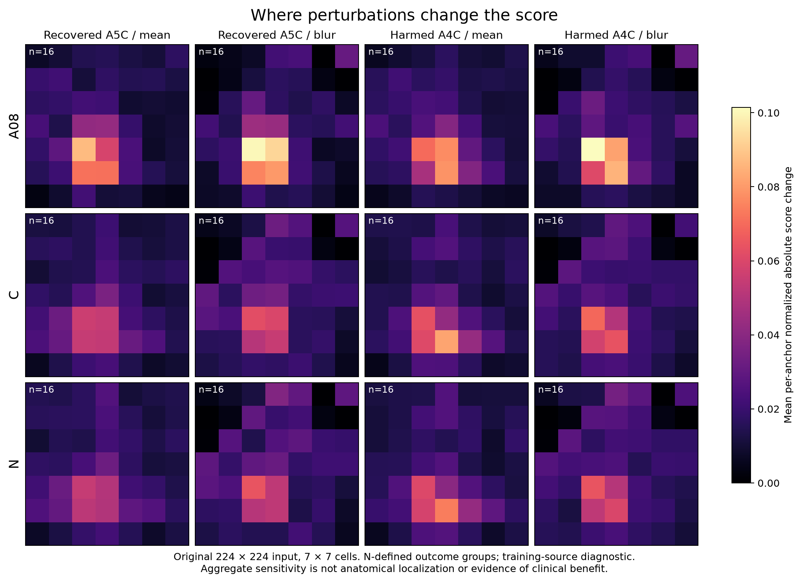

# A5C image-dependence diagnostic

**Completed and independently checked.** Frozen A08 and A44-C/N genuinely respond to image interiors and temporal context. This audit does not establish what anatomical structure they recognize. On the fixed diagnostic sample, border masking, grayscale conversion and OCR-region removal do not produce a convincing recovery/protection solution. Repeating the marked frame suppresses both correct and incorrect A5C decisions.

## Question and changed condition

The user asked whether the models use useful image details or dirty-data cues. A43–A48 changed aggregation, objectives, motion or upstream representations but repeatedly traded recovered A5C for damaged correct A4C. Those outcome counts alone did not identify the pixels driving decisions. This round freezes the existing models and intervenes on pixels, spatial cells and temporal blocks; it makes no new optimizer updates and does not tune a deployment rule.

The supplied [EV9V: A08 vs STFM website](https://echo-routing-external-tests-wq-20261030.qiuzy-william2019.chatgpt.site/) was inspected read-only at published version6. Its public result aggregates provide context only. The website was not edited, and no external-test images, labels or evaluation runner were used here. `website_context.json` binds the inspected HTML/data hashes.

## Fixed sample and actual inference

-64 original A31 training-source Base-A4C runs:16 each of A44-N-recovered A5C, missed A5C, harmed correct A4C and retained correct A4C;8/group/fold, selected deterministically without looking at image appearance or confidence. These are **N-defined outcome groups** for every A08/C/N comparison.
-55 distinct majority-source recordings/50source sessions; sessions are not independently confirmed patients. Only12/64runs are native and45/64reference-label-pure. Constructed streams and multiple-source memberships remain explicit limitations.
-All original membership rows and multiplicity weights retained:276unique window rows. Whole-run perturbations use all members; local spatial/temporal maps use the64predeclared marked-window anchors.
-Original16-frame requests, marker, gamma, short-side256resize and centre224crop, EchoPrime normalization. No comparison to a specific Helena implementation was performed. The separate PW-P1 source task uses a different square224/ImageNet pipeline; that should not be generalized to A08 preprocessing.
-A08plus the appropriate opposite-fit-fold A44-C/N weights are unchanged.28692original diagnostic window forwards,19872toroidal-control forwards and840OCR-region forwards:49404new model forwards total.5784empty-OCR slots reuse exact unchanged baseline scores. No retraining or second original baseline score pass.

Original member-score reproduction: A08 maximum absolute error3.28e-6; C/N exactly0. All pinned source/model files remain unchanged.

## Checked perturbation results

This table concerns A44-N on the **selected64runs only**, not the full103/1413efficacy denominator. Each column has16original runs. A positive score means replacement of Base-A4C by A5C; these interventions were not deployed.

| Input intervention | Recovered A5C still recovered /16 | Previously missed A5C now recovered /16 | Original A4C harms remaining /16 | New harms among retained A4C /16 |
|---|---:|---:|---:|---:|
| Original |16|0|16|0|
| Mask16px periphery |12|2|16|1|
| Grayscale |15|0|16|1|
| Chroma-proxy removal |15|0|15|0|
| Static-bright-proxy removal |15|0|16|0|
| Repeat marked frame16times |3|0|1|0|
| Full-frame letterbox |3|1|8|1|
| Same-scale letterbox, original retained footprint only |15|5|12|4|
| Offline OCR-proposed regions, mean replacement |14|1|16|0|
| Offline OCR-proposed regions, blur replacement |14|0|15|0|

Removing temporal context eliminates15of16false A5C decisions, but also loses13of16true recoveries. It therefore supplies evidence of context sensitivity, not a safe A4C protection method or proof of learned cardiac motion. Repetition is out of distribution.

The original crop retains57.7%of raw-frame area. That geometric fact does not establish that LVOT was discarded. Full versus retained-only letterboxing compares extra context at matched scale, but both differ from training inputs. Extra context lowers N scores in all four groups; it does not selectively separate A5C from A4C here.

The coarse32pxcell maps concentrate in the interior for both recovered A5C and harmed A4C. Only2of32N strongest mean-fill cells in these two positive-decision groups touch the outside cell ring (C2/32,A080/32). No cell has an anatomical label. Mean/blur agreement and a limited head-weight permutation are diagnostics, not a full-network attribution sanity guarantee. The A08 map uses its A5C-versus-A4C logit margin, whereas C/N use their binary repair score; normalized maps do not compare absolute model confidence.

The image contains only averaged7×7sensitivity values. Each anchor's absolute score changes are normalized by their sum before averaging; one common color scale is used. Brightness denotes perturbation sensitivity, not LVOT, attention, anatomy or clinical correctness. [PDF](aggregate_sensitivity.pdf) and [numeric aggregates](aggregate_sensitivity.json) are included.

## Nuisance controls and their limits

Equal-area scattered masks can themselves strongly move scores; they do not preserve connected shape. A prospectively specified supplement therefore repeats the actual masks and three112px toroidal translations with mean and blur replacement. Periodic area/boundary geometry is preserved; planar seam contact and contiguity are not. Duplicate actual-location mean masks reproduce all earlier scores exactly. Neither control permits an unqualified claim that any observed effect is exclusively text or a border shortcut.

Chroma and static-bright proxies cover very little area and cannot exclude grayscale labels or all overlays. A second prospective supplement uses local Tesseract5.3.4 on the raw and processed marked frame, with fixed confidence/box/filter rules, no cloud OCR and no new case selection. It proposes nonempty input masks for35/276rows. None has detections in both raw and processed views; largest masks cover35.6%and74.6%of input area in the two folds. This is an unstable, unadjudicated region proposal, not verified text. No exact view-code word candidate was detected; that does **not** prove absence of textual leakage.

Mean OCR-region removal loses2of16N A5C recoveries and fixes0of16N A4C harms; blur also loses2recoveries and fixes1harm. C loses2of its9recoveries on these N-selected cases and fixes0of its3harms, with either fill. These results give no convincing reason to promote OCR-based cleaning as the next solution. They also cannot prove data quality is irrelevant: OCR recall, false positives and actual anatomy were not clinically adjudicated.

## Independent verification and interpretation

`independent_audit.json` reconstructs all64cohort memberships/weights/groups and all aggregate statistics from private cached scores;518fixed original/global/spatial pixel reconstructions pass. Geometry audit reconstructs144pixel/mask/control checks and exact all-row replay. OCR audit independently reconstructs all276TSV filters/masks and48fixed intervention pixel hashes, including exact cached identity for every empty mask. The final auditor performs0new model forwards. Initial summary fields remain exactly unchanged after adding the later control summaries.

Original/code/input freezes are actual git objects before each corresponding forward stage: originalcd41e6b, toroidal5d007eb, offline OCRsource11d26f2and masks/model interventionc9f42b9. These freeze records, all three summary/audit JSONs, synthetic implementation checks and resource/closure receipts accompany this report. Private raw/processed contact sheets, per-case maps, source IDs, OCR tokens/boxes and score caches remain only on the server.

The missing evidence is **which visible anatomical or acquisition detail separates a true recovery from a false one on comparable A4C/A5C examples**. This audit localizes sensitivity only coarsely; it does not supply that semantic truth. It rules against treating simple mask/gray/static-frame changes as an already demonstrated fix. A new representation transfer question, using the existing PW-P1 correct-purpose signal with both shuffled-purpose and original-COCO controls, is separately prospectively specified in [PW-T1](../2026-10-31_pw_purpose_transfer/README.md). Its resource qualification and any actual target result are reported separately; this64-case audit supplies no new full-segmentation score.

No source2, external-test reads, label cleanup, deployment, website changes or automatic loss/gate variant. A49's global coordinate binding and A50-PW's formal source quantity failure remain closed and unchanged.
