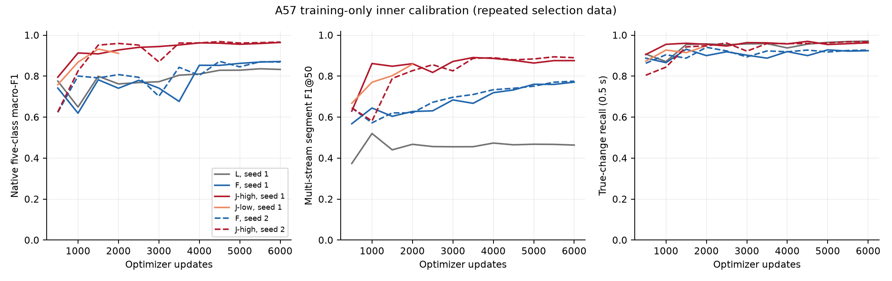
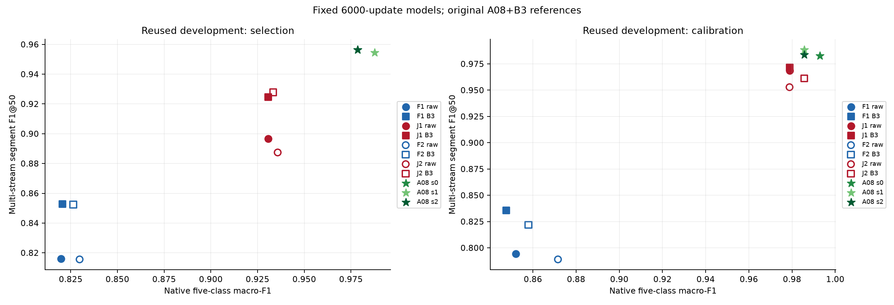
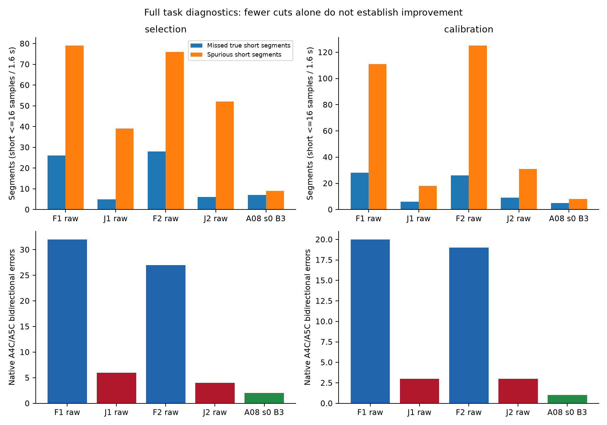

# A57：直接完整五类序列学习（核心轮完成）

**核心轮完成并独立审计：J在两个seed、两个复用外层半区均优于匹配F，但未建立超过A08。** 全部32,000次正式更新、6个模型、64次完整inner评估、17个逻辑外层行（28个去重checkpoint-half）完成。74行完整指标和12组配对比较见[汇总](summary.json)与[CSV](metrics.csv)。后续自适应full-refit已完成：局部A5C改善伴随短段FP/FN及其他类代价，未超过A08，详见[已封存结果](full_refit/README.md)。四层MD也已完成54行指标/16组配对分析：J−F在两个seed、两个半区均改善，仍未超过A08完整任务。全阶段12模型、68,000次正式更新均已完成，见[阶段对照与图表](phase_comparison/README.md)、[MD完整结果](multidepth/README.md)及[共享资源终账](resources.json)。

研究问题是：直接从EchoJEPA2.1稠密视频token预测完整五类时间轴，并把序列CE反传到全部活跃视频路径，能否改善识别与分段？本轮不依赖Base固定切点、单向A4C修复或source133准入门槛。J−F是匹配适配比较；F−L同时改变时间模块和容量，不能单独证明时间顺序机制。

[方案](../../superpowers/plans/2026-11-02-target-task-research-redesign.md)固定L/F/J-low/J-high各2000步，只用inner选J学习率，然后F/选定J/L至6000，第二seed F/J各6000。每步同一native+constructed真实2×64图像计划；64个10Hz原位置分为4个16帧块，32个tubelet经196patch空间均值、768D两stage128宽TCN预测完整五类序列。原位置CE归一化、尾部RGB复制/mask、repeat2与stride32正三角概率拼接固定；不修改真标签时间轴。

官方checkpoint全部158键严格载入；J训练149视频张量/86,237,184参数，9个图像专用/未用早层norm张量冻结。3364协议训练来源按session分为2736FIT/628inner（402/100sessions），1500/300构造流分别在分区内重建；所有完整64位置footprint检查通过。session不是患者，构造流不是临床连续扫描。预训练与EV9V重叠未知；224/16帧与官方视频ImageNet归一化是固定研究输入，不声称精确复现发布者临床训练管线。

两复用外层半区的selection为284native/120multi/137pairs、36sessions，calibration为237/120/115、36sessions。所有inner-B3选择在读取外层metadata前冻结。A08三个原seed的权重/缓存/窗口/marker/order/原B3参数严格pin，在相同10Hz完整轴上重现全部历史指标；A08是较强的运营参考，其架构、预训练与既往训练暴露不同，不是孤立架构因果对照。

固定6000步raw主结果如下；A08为预先指定s0原B3。FN16/10分母分别是真短段数，FP是未匹配的短预测段数。

| 半区 | 系统 | Native macro-F1 | Multi segmentF1@50 | 边界P / R | FN≤16 | FP≤16 | FN≤10 | FP≤10 |
|---|---|---:|---:|---:|---:|---:|---:|---:|
| selection | A08 s0原B3 | 0.97859 | 0.95635 | 0.9560 / 0.9660 | 7/141 | 9 | 3/32 | 5 |
| selection | F seed1 raw | 0.81974 | 0.81594 | 0.8194 / 0.9267 | 26/141 | 79 | 5/32 | 54 |
| selection | J seed1 raw | 0.93077 | 0.89655 | 0.8720 / 0.9634 | 5/141 | 39 | 1/32 | 30 |
| selection | F seed2 raw | 0.82976 | 0.81559 | 0.8256 / 0.9293 | 28/141 | 76 | 7/32 | 52 |
| selection | J seed2 raw | 0.93577 | 0.88742 | 0.8575 / 0.9764 | 6/141 | 52 | 2/32 | 40 |
| calibration | A08 s0原B3 | 0.99294 | 0.98269 | 0.9801 / 0.9899 | 5/134 | 8 | 2/23 | 4 |
| calibration | F seed1 raw | 0.85214 | 0.79428 | 0.7583 / 0.9146 | 28/134 | 111 | 4/23 | 79 |
| calibration | J seed1 raw | 0.97883 | 0.96854 | 0.9562 / 0.9874 | 6/134 | 18 | 0/23 | 11 |
| calibration | F seed2 raw | 0.87159 | 0.78901 | 0.7469 / 0.9196 | 26/134 | 125 | 4/23 | 88 |
| calibration | J seed2 raw | 0.97883 | 0.95283 | 0.9336 / 0.9899 | 9/134 | 31 | 1/23 | 24 |

J−F raw配对差值及95%区间如下。2000次固定seed重采样：native按完整session、multi按完整构造stream；后者只条件于该固定bank，共享来源不构成独立患者不确定性。

| 半区 / seed | Δnative macro-F1 [95%] | Δmulti segmentF1 [95%] |
|---|---:|---:|
| selection / 1 | +0.11102 [+0.01475, +0.20389] | +0.08061 [+0.03185, +0.12653] |
| selection / 2 | +0.10601 [+0.02738, +0.18978] | +0.07183 [+0.02928, +0.11456] |
| calibration / 1 | +0.12669 [+0.08165, +0.18790] | +0.17427 [+0.13726, +0.21580] |
| calibration / 2 | +0.10724 [+0.05977, +0.16970] | +0.16382 [+0.12336, +0.20631] |

inner-B3为预定补充，不能只择较好解码。J两seed的selection segmentF1为.92462/.92786（A08s0 .95635），calibration为.97176/.96117（A08s0 .98269）。J-B3−A08的selection segmentF1区间两seed均负；calibration seed1区间跨零、seed2负。区间跨零不是等效。全部三seed A08范围、固定2000/6000、inner-selected packages、raw/B3、五类混淆、双向A4C↔A5C和精确配对四格均在完整汇总/CSV中，不据外层表现重新选检查点。

局限与动因见[缓存瓶颈诊断](bottleneck_diagnosis/README.md)：selection的A5C召回J为7/11、8/11，A08为11/11；J在真变化附近的错误较少，但稳定内部错误、假短段及持续错类更多。较少真短FN并不等于整体分段更好。2位置tubelet与旧stride5最近中心的时间分辨率也不同，near变化误差不能单独证明解剖定位更好。头部stage1没有缓存，未新增前向补测。

执行证据：[模型审计](models_manifest.json)核对32,000条物理更新、全部optimizer绑定/moment/步数/学习率、149视频张量变化和9项冻结；[所有冻结读出](raw_outer_results.json)完成后，独立从概率缓存逐项重现raw指标、A08原指标和配对分析。正式producer55745e1，模型审计381946a，decoder选择fd084fb先于外层metadata8e50ed7，reader及原参考冻结b42a1b2，最终缓存汇总58bec50。私有标识、原图、权重及逐例缓存留在服务器，无push/网页改动。

补充[逐张量绑定审计](final_checkpoint_binding.json)直接验证六个模型的最终评估snapshot与已审计latest optimizer模型逐值相同（联合模型全部214项，冻结模型精确head项），不仅核对snapshot自身文件SHA。新增前向0、CPU11.435458核秒；后续refit/MD独立auditor沿用此绑定，运行中的训练producer保持不变。

[输入作用域披露](input_scope_disclosure.json)保留冻结producer曾暂时解析全局CSV非路径字段的事实；只使用allowlist路径，受保护媒体新前向0、受保护标签未用于训练/选择。独立reader使用两列路径视图。“封存”不等于声称从未解析包含保护来源的清单字段。

正式训练进程exit0，完整GPU-job墙钟23,113.8786秒、已计量CPU22,115.3546核秒；外层reader exit0，GPU-job墙钟2,818.3680秒、CPU2,730.5472核秒。两次工程预检失败及所有成功预检、CPU准备、诊断/审计成本保留在共享账本；训练结束后的空闲时间不计GPU/CPU用量。原[launch forecast](forecast.json)21.704GPUh是前瞻预测，不是已花费。后续完整实测[共享准入](full_refit/admission.json)包含保留MD及2GPUh收尾储备；阶段实际资源终账在全部授权工作结束后关闭。旧A55/A56不同口径费用原样保留，不把CPUupper与实际CPU拼成同口径总量。

下一步已经具体执行：[自适应全部训练来源CE/ST重拟合](full_refit/README.md)在本轮复用外层反馈后另立card，旧628inner转为训练、不再选择；[四层MD控制](multidepth/README.md)配置在任何本轮外层反馈前冻结、24,000步及全部固定读出已完成，保持原匹配目标与成本准入。二者保留各自结果，不改变本核心轮结论。官方test、Pediatric、Unity与隔离媒体不前向，独立临床/患者泛化及发表目标均未建立。

