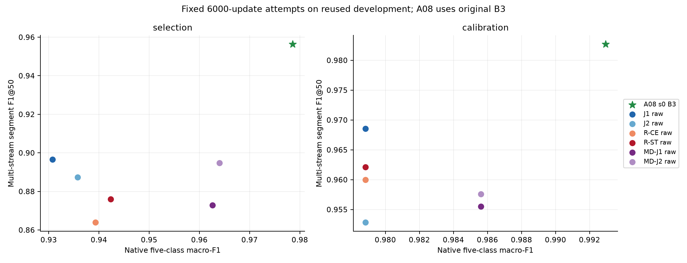
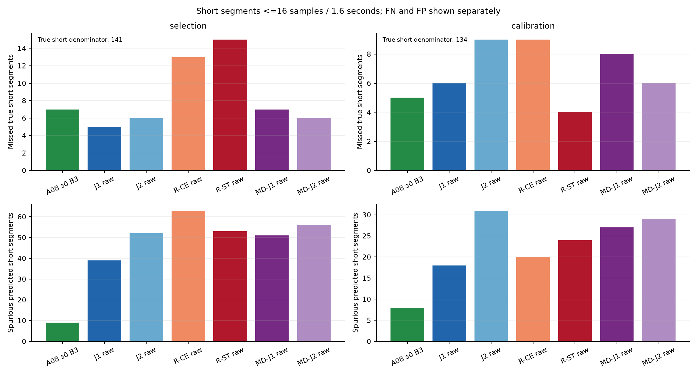
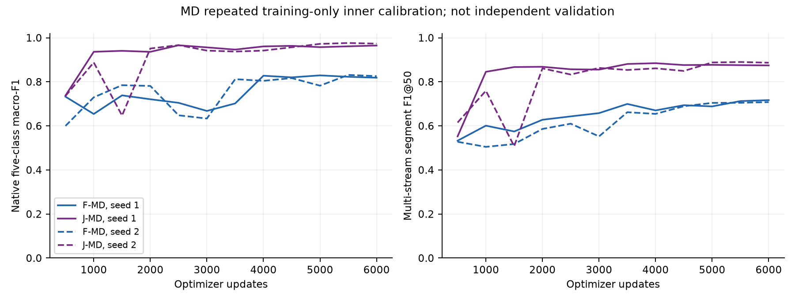

# A57全阶段：固定完整任务对照

**12个正式模型、68,000次真实优化更新、全部授权固定读出和配对分析已完成。** 核心/自适应refit/四层MD分别保留74/22/54行指标及12/20/16组配对比较；这些行复用同一开发来源，不是150组独立验证。图表只展示事先固定6000步raw行和固定A08-s0原B3；全部2000/6000/inner包、解码模式、三seed A08范围与控制留在各组件完整输出。

- [核心单层序列](../README.md)：两个seed、两个半区的J−F均有正向识别/segment配对区间；A08仍更强。更少短FN伴随更高短FP，不能据少切或局部恢复认定成功。
- [全部3364训练来源refit](../full_refit/README.md)：匹配CE/ST新鲜模型各6000步。稳定项降低训练代理损失，selection A5C7→10/11，却伴随A4C/其他类和短FN/FP代价，ST−CE segment区间均跨零；未建立完整任务改善。
- [四层MD](../multidepth/README.md)：两个seed的匹配J−F均改善。J的native点值比核心单层更高，segment方向不一致；projection容量也增加，跨深度不是孤立机制对照。raw segment低于A08的区间在四个seed-half均为负。

全阶段未建立超过A08的完整任务结果、独立患者/临床泛化或发表目标。A08是固定运营参考，架构、预训练和历史训练暴露不同；其原inner并非对A08保留的验证集。新模型的“inner J优于F”不等于“优于A08”。官方test、Pediatric、Unity和隔离媒体没有新前向；旧source133结果和失败门槛保持原样。阶段内没有自动128context、阈值/seed/loss救援或后续队列。

[固定行完整数值](fixed6000_raw_comparison.csv)、[全部图表输入SHA](figure_inputs.json)、[预先输入冻结](input_identity.json)、[48个MD内层点及逐记录SHA](multidepth_inner_curves.json)和[绘图进程回执](process.json)支持导出。三个PNG已逐张视觉检查，SVG保留矢量文字。识别/segment图为细节坐标；短段柱图从零开始，真短分母固定141/134。所有三组件的raw和三seed A08已在相同完整10Hz轴上独立重现。

曲线来自被反复用于选择的训练内session划分；不是新增独立验证。native不确定性按完整session，构造stream区间条件于固定bank，共享源不能当作独立患者。[实际资源终账](../resources.json)保留成功/失败进程及历史费用边界，预算储备不计已花费；未计量短准备另列预算allowance。
