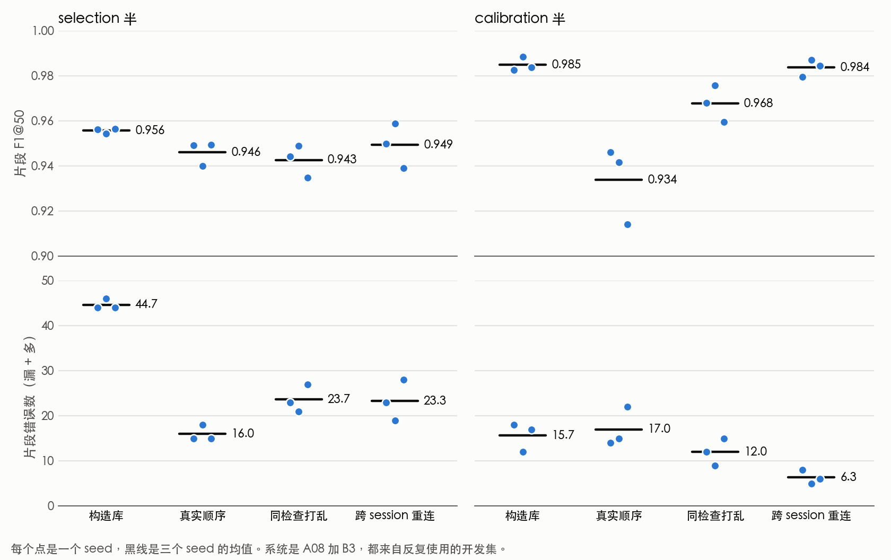

# EX1：同检查评估、检查上下文判定与选择性预测

2026-11-03 运行，服务器时间是 11-04 UTC。分支 `ex1-exam-level`，与 A60 并行，不共用队列、命名空间和账本。计划在看到任何结果之前冻结，见 [计划](../../superpowers/plans/2026-11-03-ex1-exam-level.md)。

这一轮没有训练任何模型。它只用冻结的 A08 和 B0 输出回答三个问题。

## 结论

1. **同一次检查的其他录像没有显示出稳定帮助（E2）。** OT 是唯一过 D1 门槛的方案，但区间下限只有 +.0005，去掉一个 58 段的 session 后就不过线。它在 A08 上的净修复合计为 −11，按预设规则不推荐部署。规则第 1 条没有判停，`route_continues` 是 true。我判断这条路线不值得继续，依据是 O−O0、T−P、T−S 都接近 0。这是判断，不是规则结果。
2. **真实顺序流的片段 F1 点估计更低，但不能和原有拼接流直接比高低（E1）。** A08+B3 的三 seed 均值从 .9557/.9850 变成 .9462/.9340，前者是 selection 半，后者是 calibration 半。两者录像不同，没有配对检验，真实流的区间半宽约 .04–.05。selection 半上错误数和分母一起下降。calibration 半上错误数基本不变，分母只剩四分之一。所以 .985 不能当作对真实检查的预期。
3. **开发集定不出有意义的拒判阈值（E3）。** 每半最多只有 1 个录像错误，阈值基本就是开发集里最低的置信度。用这个阈值，Dynamic 五类错误率只从约 5.2% 降到 4.35–4.77%，其中绝大多数是把 A4C 判成 A5C。LVH 和 CAMUS 的错误率下降较多，但要放弃更多录像。置信度本身有信息，事后看 Dynamic 上置信度 ≥.95 时放行 44.8–53.6%，错误率 0–0.44%。这个水平是看了外部结果才选的，不能算事先定好的阈值。
4. **合并 A4C 和 A5C 后，Dynamic 的错误率很低，但这主要来自合并本身。** 放行 92.9–97.9% 时错误率是 0–0.16%，不拒判时也只有 0.16–0.63%。LVH 和 CAMUS 的放行比例会大幅下降。
5. **置信度拒绝不了 PMPALA。** 这是本轮唯一测试的五类之外切面。46 段录像在所有 seed、口径和阈值下全部放行，全部判成 PSAX。它的标签本身有争议，所以这不能直接算错判。

## 术语

- **片段 F1@50：** 预测片段与真实片段重叠至少 50% 且类别相同才算对。F1 = 1 − (漏检片段数 + 多检片段数) / (真实片段数 + 预测片段数)。
- **B3：** A08 固定使用的变化点解码器。本轮沿用各 seed 原有参数，不重调。
- **构造库：** 开发集原有的多视图拼接流。A5C 占 19–22% 的位置。接缝绝大多数跨 session（581/612、573/599）。同 session 接缝有 57 个，其中 A4C↔A5C 只有 4 个。
- **真实顺序流：** 同一 session 的录像按序号 k 升序首尾相接，比例不变，每半 36 条流。k 只是采集顺序的间接证据。流里去掉了 PMPALA 录像，所以 449 个接缝里有 33 个跨过了一段被去掉的录像。
- **同检查打乱：** 录像和分组相同，只把每条流内部的顺序打乱。
- **跨 session 重连：** 录像和每条流的录像数相同，但所有接缝都跨 session。单条流的位置长度不同。
- **D1：** 三个 B0 对 3364 段训练录像的跨 session 留出输出，共 502 个 session。D1 样本量大，但 B0 比 A08 弱很多。
- **D2：** A08 s0/s1/s2 在开发集上的输出。转移表来自 train 标签，其余参数来自另一半。
- **净修复：** 相对只看本录像的基线 B，改对的录像数减去改错的录像数。

## E1：真实检查顺序下的表现

A08+B3 的片段 F1 如下。区间来自 5000 次整簇 bootstrap，真实顺序按时间戳重采样，构造库按流重采样。

| 半 | seed | 构造库（95% 区间） | 真实顺序（95% 区间） | 同检查打乱 | 跨 session 重连 |
|---|---|---|---|---|---|
| selection | 0 | .9563（.9311, .9767） | .9492（.8942, 1.0） | .9443 | .9499 |
| selection | 1 | .9545（.9297, .9753） | .9400（.8944, .9894） | .9489 | .9590 |
| selection | 2 | .9564（.9328, .9753） | .9495（.9132, .9871） | .9349 | .9391 |
| calibration | 0 | .9827（.9717, .9917） | .9462（.9005, .9839） | .9681 | .9796 |
| calibration | 1 | .9885（.9785, .9962） | .9416（.8889, .9842） | .9757 | .9871 |
| calibration | 2 | .9837（.9721, .9932） | .9141（.8571, .9626） | .9596 | .9846 |

三 seed 均值下，片段错误数和分母如下。错误数等于漏检加多检，分母等于真实片段数加预测片段数。

| 半 | 构造库 | 真实顺序 | 同检查打乱 | 跨 session 重连 |
|---|---|---|---|---|
| selection | 44.7 / 1009.3 | 16.0 / 297.3 | 23.7 / 413.0 | 23.3 / 460.7 |
| calibration | 15.7 / 1041.7 | 17.0 / 257.7 | 12.0 / 372.7 | 6.3 / 390.3 |

- **两者不是配对比较。** 构造库和真实流的录像不一一对应。selection 半上，构造库的三个点估计都落在真实流的区间内。calibration 半上，s0 落在区间内，s1 和 s2 在区间外。
- **分母差别主要来自片段数量。** 构造库的录像片段数是真实流的 2.58/3.03 倍（732 比 284、719 比 237）。真实流有超过一半的接缝连接同一视图（140/248、109/201），这只贡献约 1.35/1.33 倍。结果是同样一个错误，在真实流上的代价约是构造库的 3.4 倍和 4.0 倍。
- **错误数在两半上方向不一致。** selection 半上真实顺序的错误最少。calibration 半上真实顺序的错误最多。跨 session 重连的 6.3 只基于一次重连，s0 的三次重连分别有 8、8、13 个错误，真实顺序是 14 个。
- **配对比较也不一致。** 这里比较 B3 下真实顺序减同检查打乱的片段 F1。selection 半是 +.0048、−.0089、+.0146，区间都跨 0。calibration 半是 −.0219（−.0517, +.0011）、−.0341（−.0669, −.0091）、−.0455（−.0834, −.0152）。这两种流的分母也不同。
- **错误集中在少数时间戳。** 36 条流分属 25/31 个时间戳，错误只落在其中 2–6 个和 6–9 个。selection s0 的 15 个错误只在 2 个时间戳，约 13% 的整簇重采样完全不含错误，所以该格区间上限到 1.0。
- **B3 仍然有用。** 真实流上 B3 减原始逐位置预测的差值是 +.0858、+.0532、+.0880、+.0757、+.0503、+.0163。前五个区间下限大于 0，最后一个（calibration s2）区间跨 0。
- **A4C/A5C 仍是主要错误。** 把两类合并后，真实流的片段 F1 是 .9887、.9738、.9924、1.0、1.0、.9954。
- **帧准确率的差异在两半上原因不同。** 真实流是 .9534–.9790，构造库是 .9361–.9576。按构造库的类别比例重新加权后，selection 真实流仍有 .9631–.9711，高于构造库。calibration 真实流只有 .9197–.9466，不高于构造库（.9475–.9576）。所以只有 calibration 半的差异能用 A5C 比例解释。那一半上 A5C 的帧召回只有 .694–.808。
- **重连本身也有波动。** s0 的三次独立重连，selection 半是 .9499、.9474、.9469，calibration 半是 .9796、.9774、.9648。

## E2：检查上下文判定

预设规则如下。第 1 条，T、O、OT 至少一个臂要同时满足净修复大于 0、宏 F1 差值的 95% 区间下限大于 0，否则路线结束。第 2 条，只有第 1 条通过才看对照。第 3 条，通过的臂如果在 D2 六格的净修复合计小于 0，就不推荐部署。

| 方案 | 用到的信息 | A5C 判对 /217 | A4C 判对 /858 | 改对 | 改错 | 净修复 | 宏 F1 差值（95% 区间） | D2 净修复合计 |
|---|---|---|---|---|---|---|---|---|
| B | 只看本录像 | 124 | 846 | 0 | 0 | 0 | 基线 .9291 | 0 |
| P | 温度和全局先验 | 93 | 851 | 5 | 33 | −28 | −.0271（−.0373, −.0172） | −1 |
| S | 随机序转移链 | 92 | 851 | 5 | 34 | −29 | −.0281（−.0386, −.0175） | −1 |
| T | k 序转移链 | 94 | 852 | 6 | 36 | −30 | −.0263（−.0369, −.0163） | −2 |
| O0 | 只重新校准 A4C/A5C，无检查偏移 | 159 | 815 | 35 | 31 | +4 | +.0111（−.0005, +.0236） | 0 |
| O | O0 加检查级偏移 | 157 | 817 | 34 | 30 | +4 | +.0107（−.0010, +.0228） | −10 |
| OT | O 加 k 序转移链 | 158 | 818 | 34 | 28 | +6 | +.0119（+.0005, +.0238） | −11 |

- **规则结果。** 按第 1 条，OT 过线，T 和 O 没过，路线没有被判停。按第 3 条，OT 不推荐部署。所以没有得到推荐的方案。
- **OT 过线并不稳。** D1 上有 1 个 58 段的 session 走了坐标上升。去掉它后，OT−B 是 +.0100（−.0006, +.0221），净修复 +3，不再过线。这是事后检查，O 和 O0 同样处理后是 +.0087（−.0022, +.0209）和 +.0087（−.0018, +.0207）。
- **声明的对照。** O−O0 是 −.0004（−.0069, +.0055），净修复 0。T−P 是 +.0009（−.0048, +.0068），净修复 −2。T−S 是 +.0019（−.0046, +.0089），净修复 −1。所以检查内偏移和采集顺序都没有显示增益。
- **探索的对照。** OT−O 是 +.0012（−.0016, +.0045），净修复 +2。S−P 是 −.0010（−.0046, +.0022），净修复 −1。OT−T 是 +.0382（+.0238, +.0532），净修复 +36，这主要反映 T 本身的下降。
- **OT 的增益是一笔交换。** A5C 错判成 A4C 从 92 段降到 58 段，A4C 错判成 A5C 从 7 段升到 35 段。修对率与误伤率之比是 4.80，盈亏平衡点是 3.95。
- **检查内排序。** 同一次检查内的 A4C/A5C 排序 AUC 是 .9720，跨检查是 .9519。差值区间（−.0170, +.0449）跨 0，同检查配对只有 536 对。
- **P、S、T 的下降有一部分来自先验。** 事后把 T 转移链里的类别边际去掉，再重选温度，它相对 B 是 −.0047（−.0119, +.0015），净修复 −8。这比 T 的 −30 少伤害很多，但仍然没有增益。所以 T−P 的具体数值受先验影响，结论不变。

**D2 逐格。** A08 在已知录像边界时几乎没有可改的错误。

| 单元 | B 的 A5C | B 的 A4C | T 净修复 | O0 净修复 | O 净修复 | OT 净修复 |
|---|---|---|---|---|---|---|
| selection s0 | 11/11 | 87/87 | −1 | 0 | −1 | −1 |
| selection s1 | 11/11 | 87/87 | 0 | 0 | −4 | −4 |
| selection s2 | 11/11 | 87/87 | −1 | 0 | −5 | −5 |
| calibration s0 | 18/18 | 60/61 | 0 | 0 | 0 | −1 |
| calibration s1 | 18/18 | 60/61 | 0 | 0 | 0 | 0 |
| calibration s2 | 17/18 | 60/61 | 0 | 0 | 0 | 0 |

D2 上的分母太小，不声称显著。它基本只能测出伤害，测不出增益。

**计划要求的其他报告。**

- O 系列枚举时混入的真值非心尖录像，D1 上有 3 段，D2 上是 0。
- D2 上没有 session 走坐标上升。
- S 臂 5 次随机序的净修复，三折分别是 −9 到 −12、−11 到 −12、−5 到 −7。
- 高斯拟合在 D1 三折和 D2 六格都收敛。
- D1 上按位置多数投票的原有规则宏 F1 是 .9309，B 是 .9291。D2 上原有规则是 .9877/.9929，B 是 .9976/.9929，calibration s2 例外，原有规则 .9929，B .9856。
- D1 有 52/346 个时间戳跨折。同一时间戳的其他 session 可能进过训练，这可能让 D1 偏乐观。
- **存档路由参考。** 已知录像边界并逐录像判定时，B 在真实流上的片段 F1 是 selection .9896，calibration .9882、.9882、.9843。这是另一种任务，不和连续流比高下。

## E3：选择性预测

录像级置信度是窗口 softmax 均值的最大值。合并口径把 A4C 和 A5C 的概率相加后再取最大值。

**开发集跨半。** 这一项几乎没有信息量。每半五类最多只有 1 个录像错误，所以 α=1%、2%、5% 在每个 seed、每个方向上选出同一个阈值。五类放行 98.73–100%，实际错误 0–1 个，95% 单侧上界 1.27–2.00%。合并放行 98.24–100%，实际错误 0 个，上界 1.06–1.26%。

**外部数据。** 阈值来自全部开发集，基本等于其中最低的置信度，三个 α 同样选出同一个阈值。下表是三个 seed 的范围。每个外部数据集只有一种真实切面，所以错误率只反映这一种切面被判错的比例，不代表五类总体风险。

| 数据集（录像数） | 口径 | 不拒判的错误率 | 放行比例 | 放行后错误率 | 95% 单侧上界 |
|---|---|---|---|---|---|
| Dynamic A4C（1277） | 五类 | 5.17–5.25% | 97.1–98.6% | 4.35–4.77% | 5.43–5.87% |
| Dynamic A4C（1277） | 合并 | 0.16–0.63% | 92.9–97.9% | 0–0.16% | 0.25–0.50% |
| LVH PLAX（343） | 五类 | 2.33–7.87% | 88.6–94.8% | 0.63–2.63% | 1.98–4.70% |
| LVH PLAX（343） | 合并 | 3.79–9.91% | 47.8–81.3% | 0–0.86% | 1.69–2.69% |
| CAMUS（50） | 五类 | 20–36% | 42–58% | 3.45–9.52% | 15.34–27.06% |
| CAMUS（50） | 合并 | 0–8% | 14–54% | 0% | 10.50–34.82% |

- **Dynamic 五类没有达到目标。** α=1% 和 2% 明显超标。α=5% 的点估计达标，但上界超过 5%。三个 seed 放行后的错误有 54/55、52/54、55/60 被判成 A5C。
- **LVH 五类的结果随 seed 变化。** α=1% 下，s1 和 s2 的点估计达标（0.63%、0.92%），s0 超标（2.63%）。
- **合并不是没有代价。** 概率相加会让心尖类占优。LVH 上合并的不拒判错误率（3.79–9.91%）高于五类（2.33–7.87%），放行比例也更低。
- **seed 差异很大。** LVH 合并口径的放行比例是 67.6%、47.8%、81.3%。CAMUS 只有 50 段，数字只能看方向。

**事后看置信度本身。** 下面的数字是看过外部结果才算的，只说明信息是否存在。正确录像的置信度高于错误录像的概率（AUROC），五类口径下 Dynamic 是 .868–.901，LVH 是 .935–.956，CAMUS 是 .795–.897。置信度 ≥.95 时，Dynamic 放行 44.8–53.6%，错误率 0–0.44%。同样水平下，LVH 只放行 6.1–8.5%，CAMUS 放行 0%。所以高置信度确实更可靠，但不同数据集的代价相差很大，单个阈值不能通用。

**范围外录像。** 验证集有 46 段 PMPALA 录像，A08 没有训练过这一类。在三个 seed、两种口径、三个 α 下，它们全部放行，全部判成 PSAX。这个标签的英文展开有冲突，数据卡写主肺动脉长轴，STFM README 写胸骨旁长轴（心尖），见 [标签说明](../../LABEL_MAPPING.md)。所以这里只能说置信度拒绝不了它，不能说判 PSAX 一定是错的。

这些是经验曲线，不是有限样本保证。理论表要求的样本量超过现有开发集。

## 看到结果之后加的探索项

下面的内容不在计划里，只作描述。前面标为“事后”的数字也属于这一类，都在 `posthoc_checks.json`。

**A5C 紧邻 A4C 时的表现。** 计数是 B3 下的 s0/s1/s2。“整段并入”指一段 A5C 录像超过一半的位置被判成 A4C。

| 半 | 数据流 | A4C↔A5C 接缝数 | 紧邻 A4C 的 A5C 录像 | 紧邻时错判成 A4C 的位置（共多少） | 整段并入 |
|---|---|---|---|---|---|
| selection | 真实顺序 | 13 | 9/11 | 21、22、22（258） | 1、1、1 |
| selection | 同检查打乱 | 5 | 5/11 | 9、9、12（151） | 1、1、1 |
| selection | 跨 session 重连 | 8 | 8/11 | 10、13、12（227） | 0、0、0 |
| calibration | 真实顺序 | 18 | 15/18 | 180、290、289（900） | 1、2、2 |
| calibration | 同检查打乱 | 9 | 9/18 | 62、62、201（530） | 0、0、2 |
| calibration | 跨 session 重连 | 6 | 5/18 | 9、7、4（293） | 0、0、0 |

同一次检查的 A5C 录像多数紧挨着 A4C。整段并入只出现在同 session 紧邻的流里，跨 session 重连的这一次抽样在三个 seed 上都没有。构造库很难暴露这种情况，因为它只有 4 个同 session 的 A4C↔A5C 接缝。可能的解释是同一 session 的 A4C 和 A5C 外观更接近，B3 看不出变化。这个解释没有验证，涉及的录像也只有几段。

## 没有做的事

- **外部基线没有接。** A26 的外部模型结果是针对 test 做的，现有 `dev-check` 阶段只校验我方适配器。要在真实流上比较，需要为每个外部模型新写前向，不属于计划说的“能复用现有适配器”。我没有逐个适配器核查。所以 E1 里没有外部模型的对比。
- **EV9V test 没有读取结果。** test 的标签和输出没有用于任何分析，例外见“操作失误”。是否用历史 test 读一次，由负责人决定。那次读出也不能算确认性结果，因为它在 2026-10-02 之前已经用过。
- **没有训练，没有重调 B3。**

## 证据边界

结果都来自反复使用的开发数据或训练集留出折，A08 就是在这些开发数据上选出来的，所以 E1 的数字偏乐观。session 不是确认的患者。标签是公开标签，没有独立读片。B0 上的结论不能直接搬到 A08。本轮不声称临床验证，也不声称达到论文目标。

## 建议和待决定的事

我的建议如下。

- 不再做检查上下文判定。
- 以后报结果时，同时报真实顺序流和逐录像指标，不要只报构造库的 .985。
- 如果要做拒判，先准备一份错误足够多的独立校准集。现有开发集做不到。
- A4C/A5C 的划分仍然需要独立读片，这一点本轮没有改变。

以下事项由负责人决定。

- 是否合并这个分支。它的索引行和 A60 分支可能需要手工合并。
- 是否用历史 test 读一次。
- 是否请人确认 PMPALA 的标签，以及是否要做五类之外的拒判。
- 这 0.48 GPU 小时是否并入共享账本。

## 运行与核验

- **流水线校验全部通过。** 同一套指标代码复现了 A08 缓存的 multi 片段 F1 和原生宏 F1。新前向在三个 seed 上复现缓存概率，最大差约 3e-7。这个一致性检查每半用 12 段录像，不是全部录像。
- **数据流可复现。** 重建后原有 6 个文件的 SHA256 不变。
- **独立复核。** 另一个智能体用自写代码从服务器数组重算了 E1 全部单元和配对区间、E2 的基线计数和净修复、E3 全部结果和紧邻表，4 位小数一致。E2 各臂的解码复用了 `clip_models`，所以这部分只有计数是独立的。它指出的不当表述已经改正，它算出的新数字我用 `scripts/ex1_posthoc_checks.py` 复现后写入了 `posthoc_checks.json`。
- **一处计划更正。** 计划第 1 节写的 575/581 个跨 session 接缝与实际计数（581/612、573/599）不符。计划保持冻结，在这里更正。
- **资源。** GPU 墙钟 0.48 小时，低于 0.5 小时自限。计划里预估的 0.55–0.6 小时没有发生。存储 18 MB。详见 `resources.json`。这 0.48 小时不在 A60 的共享账本里。
- **隐私。** 公开文件里搜索真实时间戳，0 命中。逐例输出和录像 ID 都留在服务器。
- **测试。** 单元测试 52 个全部通过，整体覆盖率 67%，低于项目 80% 的规则。`io` 和 `decode` 没有单元测试，只靠参考数值复现来验证。服务器上没有 mypy 和 ruff，所以类型和 lint 没查。事后脚本没有单元测试。

**操作失误。**

1. 写探查脚本时打印过 10 个训练集 session ID 和两条去 ID 的 EV9V test 标签值。它们只进了本地会话记录，没有进入任何分析或公开文件。
2. 第一次隐私检查读取了清单全部行，其中包含 test 行。只用了 `video_id` 来搜索，没有打印，也没有用标签。
3. 跑覆盖率时覆盖了服务器项目根目录原有的 `.coverage`。这是可以重新生成的测试产物。
4. 第一个等待脚本用 `pgrep` 匹配到了自己，永远不会结束。前向跑完后空等了约 52 分钟，没有多花算力。

## 文件

- `benchmark.json`、`benchmark.csv`：E1 全部单元和配对比较。
- `clip_context.json`、`clip_context.csv`、`clip_context_controls.json`：E2 和判停线。
- `selective.json`：E3。
- `posthoc_adjacency.json`、`posthoc_concentration.json`、`posthoc_checks.json`：读结果之后加的探索项。
- `prepare.json`、`forward_receipt*.json`、`resources.json`：数据流结构、前向回执和资源。
- 代码在 `exam_level/`、`scripts/ex1_*.py` 和 `tests/test_exam_level.py`。逐例输出和录像 ID 留在服务器 `runs/ex1_exam_level_v1/`。
