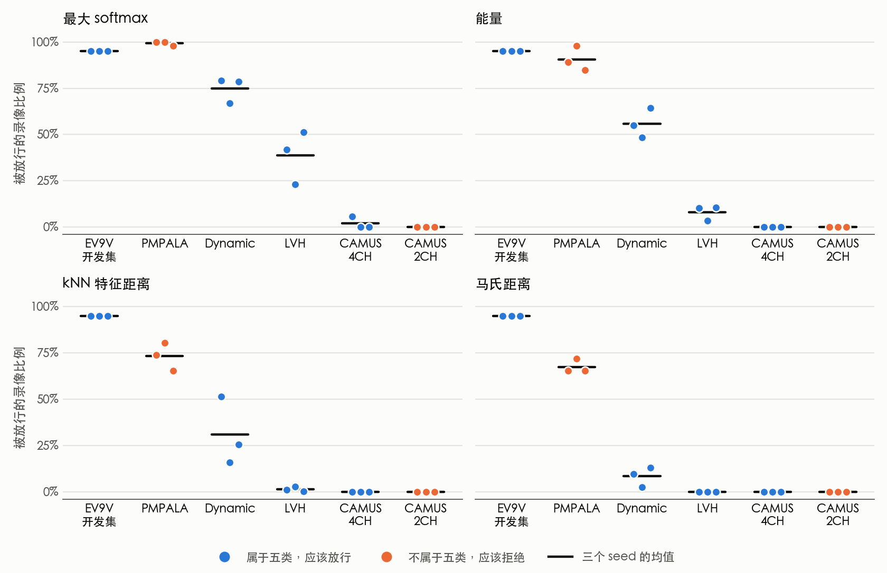

# EX2：真实顺序复核、开集测试、解码器重调与数据清理

2026-11-04 运行。分支 `ex2-open-routing`，紧接 EX1。计划在看到任何 EX2 结果之前冻结，见 [计划](../../superpowers/plans/2026-11-04-ex2-open-routing.md)。论文主任务也在此之前选定，见 [决定](../../paper/NARRATIVE_DECISION.md)。这一轮没有训练任何模型。

## 结论

1. **A60 的增益在真实顺序上没有通过预设规则（X1）。** J-R 相比 A08 是 −.0003、−.0003、+.0110、+.0148，四个区间都跨 0。放宽动作预算也没有改善。我建议不开 A61。
2. **看着真实标签选动作时，安全约束几乎不降低上限（X2）。** 真实流上的 oracle 增益是 +.0171 和 +.0228，所以“基本没有空间”这条判定没有成立。这是用标签挑出来的上限，不代表模型能做到。它只相当于每半多对 3 个和 2 个片段。
3. **没有一种打分能把五类之外和五类之内分开（X3）。** 四种方法都没有达到预设标准。CAMUS 的 2CH 确实几乎全被拒，但同一批患者的 4CH 也几乎全被拒。标签有争议的 PMPALA 反而被放行 65–100%。分数对数据来源的反应，比对切面的反应强得多。
4. **把 B3 重调到真实流上，未检测到一致差异（X4）。** 点估计大多变差，选出的设置也不稳定。
5. **没有看到大规模标签错误的信号（D）。** B0 把 A5C 错判成 A4C 的 90 段录像里，两名 AI 读者同时反对官方标签的只有 3 段。这条规则至少要 27 段才会触发，所以少量标签错误排除不了。读片只是伪标签。机械审计没有发现大的问题。

**这些结果合在一起的含义。** B0 的 A5C 错判，主要不是两名 AI 读者能看出的标签错误。解码器重调、检查上下文和动作编辑也都没有稳定解决 A4C/A5C。系统还不能可靠地判断一段录像是否超出了它的范围。

## 术语

- **Base：** A08 s0 加原始 B3。
- **J-E、J-R：** A60 冻结的 JEPA 头加两种策略。E 只按预测收益接受动作，R 再加风险否决。
- **真实顺序流（exam）：** 同一 session 的录像按序号 k 首尾相接，每半 36 条。
- **跨 session 重连（rewired）：** 录像相同，但所有接缝跨 session。
- **oracle：** 看着真实标签选最优动作得到的上限，不能部署。
- **开集测试：** 给系统看不属于五类的录像，看它能不能和五类之内的录像分开。
- **AUROC：** 随机取一段五类内和一段五类外的录像，前者分数更高的概率。0.5 等于随机。
- **放行比例：** 分数不低于阈值的录像比例。阈值都取能保留 95% 开发集录像的那个值。

## X1：A60 的冻结头在真实顺序流上

头、策略和阈值都没有改动。流水线精确复现了 A60 保存的 240 条预测。JEPA 前向和 A60 缓存的最大差是 0。

下表是片段 F1 相对 Base 的差值。Base 是 selection .9492、calibration .9462。帧错误变化为负表示错误减少。

| 半 | 头 seed | J-E（95% 区间） | J-E 帧错误 | J-R（95% 区间） | J-R 帧错误 |
|---|---|---|---|---|---|
| selection | 360 | −.0131（−.0496, +.0167） | −4 | −.0003（−.0238, +.0174） | −37 |
| selection | 361 | .0000（−.0329, +.0233） | −79 | −.0003（−.0238, +.0174） | −45 |
| calibration | 360 | +.0040（−.0316, +.0430） | −46 | +.0110（−.0133, +.0439） | −32 |
| calibration | 361 | +.0110（−.0133, +.0439） | −35 | +.0148（−.0085, +.0470） | −30 |

- **规则结果。** 预设规则要求四格都大于 0、至少两格区间下限大于 0、帧错误都不增加。J-E 和 J-R 都没有通过。
- **对比其他数据流。** 同样的 J-R，在 A60 新构造确认库上是 +.0184、+.0178、+.0134、+.0080，在主表上是 +.0059、+.0059、0、−.0019。A60 的压力库和确认库有 9/12 格区间下限大于 0，主表和真实流都是 0/4。
- **我的预测只对了一半。** 我事先预测增益会大幅缩水。这在 selection 半成立。calibration 半的点估计（+.0110、+.0148）和新构造确认库的 calibration 半（+.0134、+.0080）差不多，没有缩水。
- **calibration 半的点估计不是靠修复短段。** 那里 J-R 没有多匹配片段，匹配数仍是 123。增益来自预测片段变少（132 降到 129、128）。
- **放宽动作预算也没有改善。** 每条流按整段录像切块、每块最多一个动作后，J-R 是 −.0068、−.0003、+.0037、+.0148，J-E 是 −.0189、−.0127、−.0032、+.0037，区间都跨 0。
- **短段反而多漏了。** selection 半有 14 个真实短段，Base 漏 2 个，J-R 漏 3 个。calibration 半有 8 个，Base 漏 0 个，J-R 漏 1 个。
- **帧错误减少是一笔交换。** J-R 让 A4C 错判成 A5C 减少（selection 从 154 帧到 125、129，calibration 从 151 帧到 95、102）。同时 A5C 错判成 A4C 增加（selection 从 21 帧到 32、30，calibration 从 180 帧到 222、219）。
- **动作价值估计仍然不准。** J-R 接受了 12、15、20、15 个动作，其中真实收益为正的只有 1、1、2、2 个。预测的帧错误变化合计是 −62.9、−85.2、−85.2、−82.5，真实是 −37、−45、−32、−30。
- **桥接对照。** 跨 session 重连上，J-R 在 selection 半是 +.0106、+.0064，calibration 半是 0、0。J-E 在 selection 半是 +.0131、+.0110，calibration 半是 −.0050、−.0074。这里只有点估计。

## X2：帧安全约束下的 oracle

不筛选的结果精确复现了 A60 的 16 行。下表是 expanded 域、保留 G 约束时，oracle 相对 Base 的增益。双重筛选指真实位置错误数和真实假短段数都不增加。这里的“安全”只指这两项计数。

| 表 | selection 不筛选 | selection 双重筛选 | calibration 不筛选 | calibration 双重筛选 |
|---|---|---|---|---|
| 主表 | +.0199 | +.0198 | +.0048 | +.0048 |
| A58 压力库 | +.0773 | +.0751 | +.0447 | +.0446 |
| A59 确认库 | +.0657 | +.0632 | +.0440 | +.0438 |
| A60 确认库 | +.0722 | +.0667 | +.0405 | +.0400 |
| 真实顺序流 | +.0171 | +.0171 | +.0228 | +.0228 |
| 跨 session 重连 | +.0219 | +.0111 | 0 | 0 |

- **规则结果。** 真实流两半的双重筛选增益都不低于 .01，所以“基本没有安全空间”这条判定没有成立。这不等于证明了空间可以拿到。
- **这回答了 A60 留下的问题。** 除了跨 session 重连的 selection 半，这两项约束几乎不降低上限。所以帧损害不是这个动作域必然带来的。问题出在动作的价值估计、准入和风险取舍上，A60 没有把这几项分开，这里也没有。
- **这个空间很小。** 真实流上，oracle 相比 Base 的匹配片段数从 140 到 143、从 123 到 125。X1 的配对差值区间半宽约 .02–.04，所以即使做到，现有开发集也很难测出来。
- **只用旧动作域时。** 真实流上的增益是 +.0036 和 0。

## X3：开集测试

蓝点属于五类，应该放行。橙点不属于五类，应该拒绝。开发集的 95% 是阈值决定的。

主要指标是同一批 500 名 CAMUS 患者上，4CH 相对 2CH 的 AUROC。下表是三个 seed 的范围。

| 方法 | AUROC（4CH 对 2CH） | 2CH 放行 | 4CH 保留 | Dynamic 保留 | LVH 保留 | PMPALA 放行 |
|---|---|---|---|---|---|---|
| 最大 softmax | .740–.782 | 0% | 0.2–5.8% | 67.0–79.2% | 23.0–51.3% | 97.8–100% |
| 能量 | .714–.762 | 0% | 0% | 48.5–64.2% | 3.5–10.5% | 84.8–97.8% |
| kNN 特征距离 | .751–.813 | 0% | 0% | 15.8–51.5% | 0.3–2.6% | 65.2–80.4% |
| 马氏距离 | .699–.753 | 0% | 0% | 2.5–13.0% | 0% | 65.2–71.7% |

- **规则结果。** 四种方法都没有达到“可用”，AUROC 和外部保留率都不达标。这是这个项目第一次用 CAMUS 2CH 测 A08，是预先写定的读出。
- **2CH 被拒不是分辨出来的。** 同一批患者的 4CH 也几乎全被拒。CAMUS 内部的 AUROC 不超过 .813，所以即使在目标数据集上单独定阈值，也不能很好地分开 A2C 和 A4C。
- **分数对数据来源的反应更强。** 开发集相对 CAMUS 2CH 和 4CH 的 AUROC 都不低于 .985，相对 PMPALA 只有 .313–.825。
- **阈值放到最松也一样。** 取开发集的最低分时，最大 softmax 下 2CH 放行 4.8–14.2%，4CH 保留 39.6–55.6%，Dynamic 97.0–99.3%，LVH 88.6–94.8%，PMPALA 100%。
- **开发集内部也不均匀。** 最大 softmax 的阈值下，开发集 A4C 只保留 86.5–88.5%，A5C 只保留 72.4–82.8%。所以外部 A4C 不能直接和整体的 95% 相比。
- **阈值在开发集两半之间是稳定的。** 用一半定阈值，另一半的实际保留率是 91.5–98.7%。
- **A2C 大多被送到心尖类。** 三个 seed 中，全部 500 段 2CH 判成 A4C 或 A5C 的有 330、382、301 段。去向在 seed 之间差别很大，判成 PLAX 的有 1、0、165 段。
- **PMPALA 全部判成 PSAX。** 它的标签有争议，所以这里只说放行，不说判错。这也是这一轮唯一被大量放行的五类之外录像。

**一个混杂因素，事后检查过。** CAMUS 是半个心动周期的序列，97.8–99.8% 的录像只够 1 个窗口，其他数据的中位数是 5–8 个。所以我把开发集录像也截成中间 4 个位置、1 个窗口，再用同样的阈值。

| 方法 | 截短后的开发集保留 | CAMUS 4CH 保留 |
|---|---|---|
| 最大 softmax | 83.7–91.6% | 0.2–5.8% |
| 能量 | 59.9–65.1% | 0% |
| kNN 特征距离 | 27.8–41.8% | 0% |
| 马氏距离 | 4.0–10.4% | 0% |

截短后的开发集相对 CAMUS 4CH 的 AUROC 是 .957–.999，五类准确率仍有 .964–.975。所以输入太短确实会压低分数，对特征距离影响很大，但它解释不了全部差距。剩下的差距里混着设备、半周期采样和类别比例，这里分不开。Dynamic 和 LVH 的长度和开发集相近，保留率也偏低。

## X4：在真实顺序上重调 B3

每个 seed 在一半的真实流上选设置，用到另一半。

| 测试半 | seed | 原 F1 | 重调后 F1 | 差值（95% 区间） | 帧错误变化 |
|---|---|---|---|---|---|
| selection | 0 | .9492 | .9156 | −.0336（−.0562, −.0099） | +79 |
| selection | 1 | .9400 | .9530 | +.0130（−.0116, +.0485） | +20 |
| selection | 2 | .9495 | .8990 | −.0505（−.0938, +.0004） | +91 |
| calibration | 0 | .9462 | .9323 | −.0138（−.0514, +.0172） | −83 |
| calibration | 1 | .9416 | .9032 | −.0384（−.0793, −.0065） | +273 |
| calibration | 2 | .9141 | .9213 | +.0073（−.0187, +.0305） | −258 |

未检测到一致差异。三个 seed 的区间在两半上都不在同一侧。选出的 half_window 从 7 到 15 不等，设置不稳定。这不是等价的证明。

## D：数据清理

官方标签没有改动。范围是 EV9V train 和 validation，共 4250 段录像。

**D1 机械审计。**

- **完全相同的文件：** 0 对。
- **跨 session 的相似帧：** 相关系数不低于 .95 的有 12 对，涉及 15 段录像。其中跨 train 和 validation 的 0 对，跨两半的 0 对，同一时间戳的 2 对。
- **这不等于重复录像。** 12 对都只在抽取的 5 帧中的 1 帧上相似，其他帧的最佳相关中位数是 .768。有一组 5 段录像占了 7 对。
- **标签冲突：** 12 对里有 6 对原始编码不同，但只有 1 对属于不同的五类，A4C 和 A5C 之间的冲突是 0 对。
- **静止录像：** 32 段。**过短录像：** 0 段。
- **彩色标记规则失效。** 它标记了 4233 段。事后检查发现，整帧的彩色像素比例集中在 2.12–2.82%，来自固定的界面元素。中心裁剪后没有一段达到 2%，整帧也没有一段达到 5%。所以没有彩色多普勒录像的迹象，这条规则本身没有区分力。
- **局限。** 每段只取 5 帧做哈希，所以可能漏掉一部分。EV9V test 没有检查。

**D2 盲法 AI 读片。** 201 段录像加 20 张重复图。两名读者是相互独立的新智能体，看不到标签、模型输出和分层。

| 分层 | 录像数 | 官方标签 | 读者 1 判 A5C | 读者 2 判 A5C | 两人都反对标签 | 两人都同意标签 |
|---|---|---|---|---|---|---|
| B0 把 A5C 投成 A4C | 90 | A5C | 70 | 68 | 3（3.3%） | 63 |
| A5C 对照 | 30 | A5C | 22 | 26 | 2（6.7%） | 22 |
| B0 把 A4C 投成 A5C | 6 | A4C | 3 | 3 | 3（50%） | 3 |
| A4C 对照 | 30 | A4C | 2 | 3 | 1（3.3%） | 24 |
| 开发集全部 A5C | 29 | A5C | 25 | 25 | 3（10.3%） | 24 |
| 开发集平均证据规则判错的 A4C | 1 | A4C | 0 | 0 | 0 | 1 |
| 开发集随机 A4C | 15 | A4C | 2 | 2 | 2（13.3%） | 13 |

- **规则结果。** 没有标签问题信号。这条规则至少要 27/90 才会触发，所以它只能排除大规模的标签错误。
- **能说到哪一步。** B0 的 A5C 错判，主要不是两名 AI 读者能看出的标签错误。这不等于证实是模型错误。B0 也不是 A08。
- **对照的比较不稳。** 两人都明确反对标签的比例，B0 错判层（3/90）低于对照层（2/30）。如果把“不确定”也算上，两人都没答 A5C 的比例是 15/90 和 4/30，方向就反过来了。两层很接近，所以不要把这个方向当成结论。
- **还有第三种可能。** 判为 A5C 的分层里，4 帧中平均只有约 1.6–2.2 帧清楚看到流出道或主动脉瓣。B0 错判层是 1.69 和 1.64，A5C 对照层是 1.93 和 2.00。A4C 对照和开发集随机 A4C 是 0.07–0.20，B0 把 A4C 投成 A5C 的那 6 段是 0.67。所以一个录像标签可能覆盖了不均匀的内容，这可能和模型错误同时存在。
- **A4C→A5C 这一小层值得注意。** 6 段里有 3 段被两人都判成 A5C，但样本太小。
- **信度。** 两名读者的 kappa 是 .749，完全一致率 87.1%。
- **重复图不能算独立重测。** 两人都是 20/20。读者 2 在回复里说它认出了重复图并沿用答案，这句话文件里没有记录。读者 1 没有这样说，但也不能排除。
- **读片判据偏向 A5C。** 至少一帧看到流出道就答 A5C，所以 A4C 对照里也有 2–3 段被判成 A5C。
- **读者的准确率没有测量。** 为了不把 Unity 的专家帧发给模型，这里没有专家参照。

**敏感性分析。** 排除两人都反对标签的 14 段录像后，结果变化很小。这里的宏 F1 是官方标签上的录像层指标。

| 数据 | 平均证据：全部 | 平均证据：排除后 | 位置投票：全部 | 位置投票：排除后 |
|---|---|---|---|---|
| D1（B0） | .9291 | .9325 | .9309 | .9335 |
| A08 selection | .9976 | .9976 | .9877 | .9859 |
| A08 calibration s0、s1 | .9929 | .9926 | .9929 | .9926 |
| A08 calibration s2 | .9856 | .9926 | .9929 | .9926 |

calibration s2 平均证据的变化，来自它唯一判错的那段 A5C，这段被两名读者都判成了 A4C。再排除相似帧里的类别冲突，D1 只变成 .9325 和 .9334。这一轮没有用清理后的数据重新训练。

**开发集录像错误数，按判定规则。** 这说明“每半最多错 1 段”只对窗口平均规则成立。

| 半 | 窗口平均 | 位置投票 | B3 多数 |
|---|---|---|---|
| selection（284 段） | 1、1、1 | 2、2、2 | 3、2、3 |
| calibration（237 段） | 1、1、1 | 1、1、1 | 1、2、2 |

## 对论文的影响

论文的主任务和叙事在读这些结果之前已经冻结，这些结果没有改变它。

- **Q3 有了预先写定的答案。** 这些打分方法不能可靠地分开五类之外和五类之内，开发集阈值也不能跨数据集使用。
- **Q4 多了一条证据。** 动作编辑的增益出现在短段富集的压力库和确认库上，主表和真实流都没有。
- **A4C/A5C 只能写成探索性结果。** 读片是 AI 伪标签。

## 我的建议

- 不开 A61，也不再做新的模型变体。X2 的空间太小，现有数据很难测出来。
- 开始按[提纲](../../paper/OUTLINE_v2.md)写论文。
- 如果以后要做拒判，需要带“其他切面”标签的数据，并且在目标数据集上校准。现有方法做不到。

## 还需要作者决定

1. **AI 使用声明。** 这轮的 AI 读片如果进入论文，就必须披露。之前的决定是稿件不写 AI 使用声明，这两者冲突。
2. **是否用历史 test 跑一次真实顺序流。** 它不算确认性结果。
3. **是否合并分支。** `ex2-open-routing` 基于 EX1，索引行需要和 A60 分支手工合并。
4. **这些 GPU 小时是否并入共享账本。**

## 证据边界

这些都是反复使用的开发数据或公开外部数据上的诊断。session 不是确认的患者。AI 读片不是专家标注，不能作为参考标准。CAMUS 的 2CH 和 4CH 是数据集给定的编码，4CH 里可能含 A5C。外部数据集只有部分切面。本轮不声称临床验证，也不声称达到论文目标。

## 运行与核验

- **校验全部通过。** A08 嵌入前向和缓存的最大概率差约 1e-7。Dynamic 样本 400 段、LVH 全部 343 段、CAMUS 测试组 50 段的 4CH 和 A50 逐段一致，最大差不超过 5e-8。JEPA 差值是 0。
- **资源。** GPU 墙钟 0.69 小时，低于 1.2 小时上限。存储 34 MB。详见 `resources.json`。
- **隐私。** 公开文件里搜索 train 和 validation 的 396 个真实时间戳，0 命中。没有患者编号。录像 ID、读片密钥和逐例输出都留在服务器。
- **媒体例外。** 按负责人的数据清理授权，EV9V（CC-BY-4.0）的 221 张拼图曾临时放在本地会话目录，供两名读者和我的 10 张抽查读取，读完已删除，没有进入仓库。Dynamic、LVH、Unity、CAMUS 的图像都没有发给模型。
- **代码复核。** 读结果之前，独立智能体发现 8 个问题，包括重复图配错、审计脚本会崩溃、文件时间可能泄露分层。都已修复并写入计划。
- **事实复核。** 另一个独立智能体用自写代码重算了 X1、X2 的真实流行、X3、X4、D1、D2，4 位小数一致。它指出的过强表述已经改正，它算出的新数字我用 `scripts/ex2_posthoc_wording.py` 复现后写入了 `posthoc_wording_checks.json`。
- **测试。** 全部通过。类型和 lint 没查，因为服务器上没有 mypy 和 ruff。事后脚本和读出脚本主体没有单元测试，靠参考数值复现验证。

**EV9V test 的边界。** 这一轮没有用 test 的标签、输出或帧做任何分析。外部清单和帧目录表在内存中解析时含有 test 行，随即丢弃。

**操作失误。**

1. 事实复核智能体遍历 A50 的公开结果文件时，打印过其中 EV9V test 的聚合混淆矩阵。没有逐例行和 ID，这些是已发表的历史结果，没有用于任何结论。
2. 短输入检查第一次启动时，一个导入把 GPU 隐藏了，5 秒内失败，没有做任何计算。

## 文件

- `x1_a60_real_order.json`、`x2_safe_oracle.json`、`x3_open_set.json`、`x4_b3_retune.json`：四个实验。
- `d1_mechanical_audit.json`、`d2_reading_set.json`、`d2_reading_results.json`：数据清理。
- `posthoc_short_input.json`、`posthoc_colour.json`、`posthoc_wording_checks.json`：读结果之后加的检查。
- `forward_receipt_*.json`、`resources.json`：前向回执和资源。
- 代码在 `open_routing/`、`scripts/ex2_*.py` 和 `tests/test_open_routing.py`。
