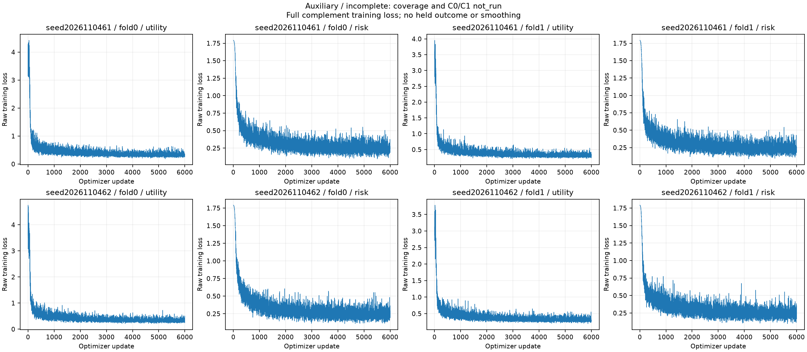
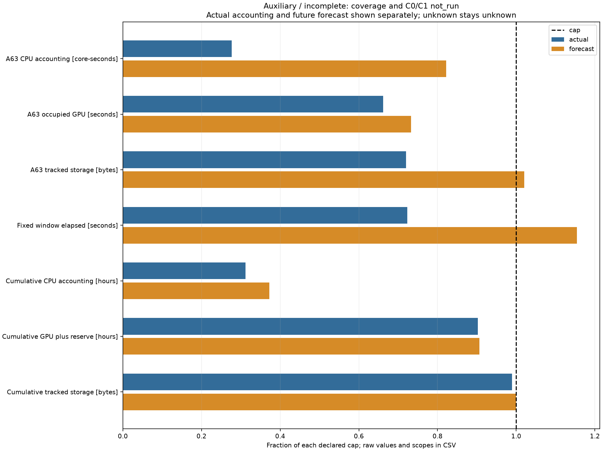

# A63 continuation: resource-stopped before coverage

The continuation completed the FIT teacher cache and all eight auxiliary heads, including their independent audits. It stopped before held scoring, coverage, or formal C0/C1 execution. The scientific comparison remains **unevaluated**; this is neither a failed coverage gate nor evidence against C1.

The only final full remaining-work admission, after the bounded zero-NN cost measurement, refused both the fixed deadline and the lifecycle storage forecast. It predicted completion at **2026-11-06T10:32:55.084612+00:00**, beyond the unchanged **2026-11-06T08:41:34+00:00** deadline by **6681.084612 s**. Its complete future tracked upper was **1,326,534,880 B**, exceeding the approved **1,300,000,000 B** by **26,534,880 B**. The current tracked upper at that refusal was **928,996,140 B**. Forecasts are not actual consumption or physical lower bounds.

| Evidence | Actual status |
|---|---|
| FIT committed teacher payloads | 6,000, across four complete journals |
| Recorded original producer invocation | 88,731 A08 windows; 15,150 JEPA chunks |
| All-attempt teacher forward units | Unknown (`null`), not inferred from cached vectors |
| Auxiliary models / optimizer updates / full states | 8 / 48,000 / 32, independently audited |
| Coverage | Not run; `null`, no pass/fail verdict |
| Formal C0/C1 instances / updates | 0 / 0 |
| CONFIRM, calibration, outer endpoints, paired CI, support, native/regression | Not run |

The original source child exited 0 while its enclosing stage exited 1 after exceeding its CPU stage allocation. That failed receipt and all charges remain unchanged. A separate successful CPU-only adoption verified all 6,000 payloads; it did not rerun teachers. Every auxiliary head completed exactly 6,000 updates and four full states, was independently audited, and was archived before the next head.

## Observed training and resource evidence

All 48,000 original loss points are shown without smoothing. Fold labels are held folds; training used the corresponding complement. Objectives and vertical scales differ by role. Training loss does not establish held-out safety, coverage, calibration, or routing effectiveness. [PDF](incomplete_figures_v1/auxiliary_learning_curves.pdf) · [CSV](incomplete_figures_v1/auxiliary_learning_curves.csv)

Blue values are the declared accounting/current tracked upper at the figure cutoff; orange values are the earlier refused complete forecast. CPU accounting includes explicit administrative allowances. Cumulative GPU bars include the inherited 2-hour reserve, which is not measured GPU use. Storage is logical tracked accounting with declared rooms/proxies, not physical blocks, RAM, or a measured global peak. The figure cutoff excludes its own rendering and final publication tail. [PDF](incomplete_figures_v1/resource_admission.pdf) · [CSV](incomplete_figures_v1/resource_admission.csv)

## Authoritative artifacts

- [Final full-work stop decision](actual_resource_stop_decision_v1.json), binding the actual refused caller and guardian receipts.
- [Resource-stop terminal snapshot](negative_terminal_snapshot.json) and [original closing resource cutoff](resources_negative.json). The closing child, guardian, and directly waiting parent exited 0; administrative success does not complete the scientific matrix.
- [Independent auxiliary audit](aux_model_audit.json), [models manifest](aux_models_manifest.json), and [physical completion](aux_physical_completion.json).
- [Actual figure receipt](incomplete_figure_receipt_v1.json), [figure resource cutoff](incomplete_resource_plot_cutoff_v1.json), and [render parent receipt](incomplete_render_parent_v2.json).
- [Independent actual PNG/PDF/CSV QA](../2026-11-05_a63_resume_preparation/root_actual_incomplete_visual_QA_v1.json). The original figure receipt remains unchanged with its initial QA-false field; independent approval is a separate receipt.
- [Final declared storage bound](final_storage_bound_v1.json) preserves actual files and all remaining publication/unknown rooms, without changing the refused scientific forecast.
- [Final accounting supplement](post_closure_accounting_v1.json). Immutable runtime cutoffs, original failures, measured subtotals, allowances, and unknown tails remain distinct. Actual main publication is verified separately after the public manifest freezes.

The approved fixed window remains 2026-11-05T20:41:34+00:00 to 2026-11-06T08:41:34+00:00. The storage amendment changed only the lifecycle allowance from 1.0 to 1.3 GB; CPU, GPU, cumulative caps, original usage, and the scientific matrix were not reset. All scientific execution has stopped. No A64 or further forecast-adjustment loop is started. `overall_complete` remains false for the unevaluated scientific workflow.
